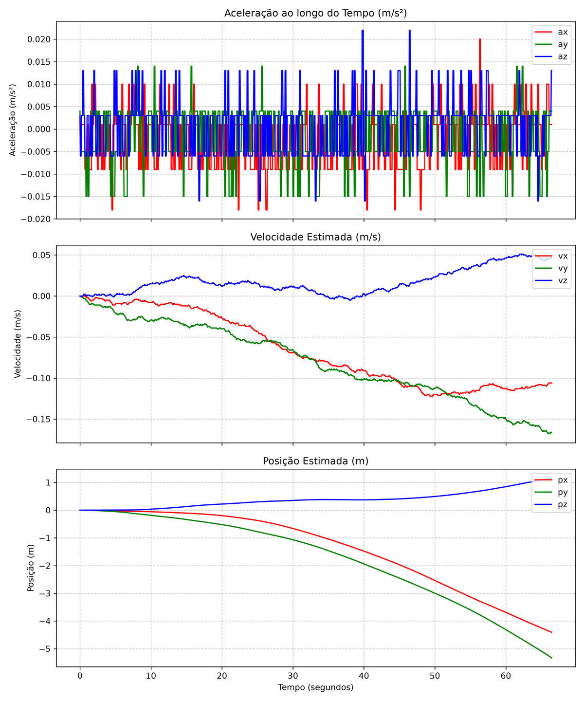
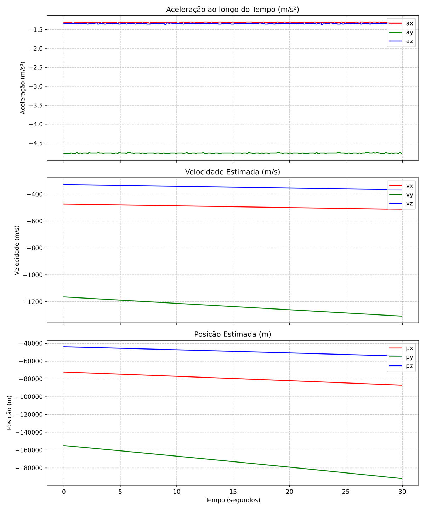
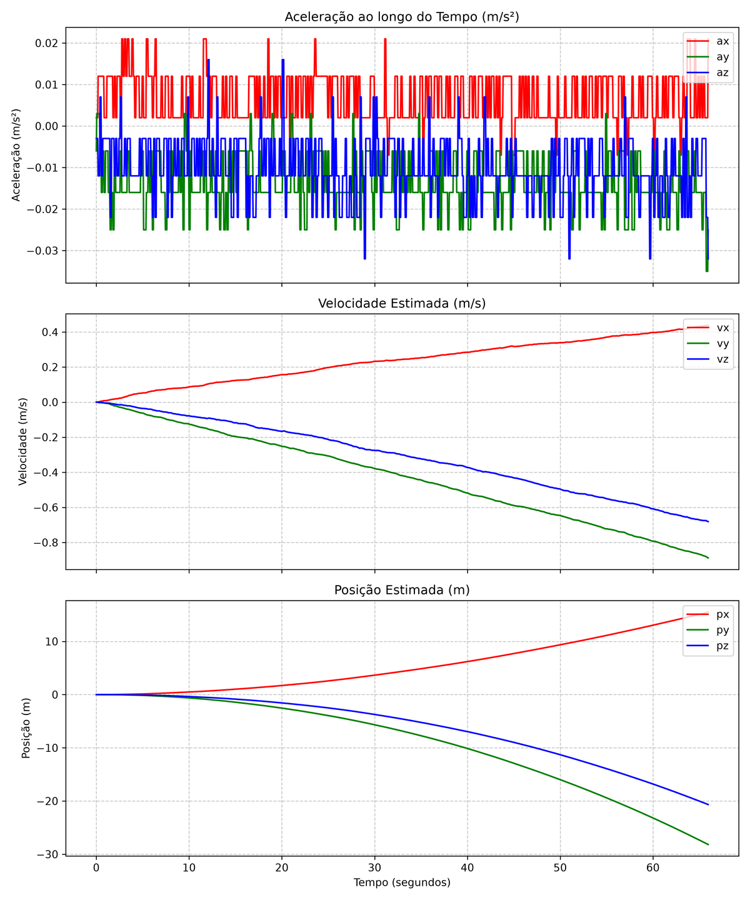
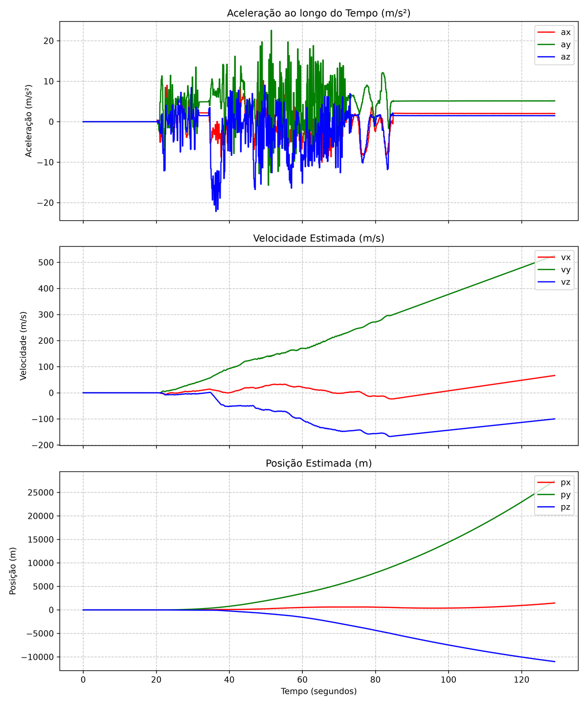
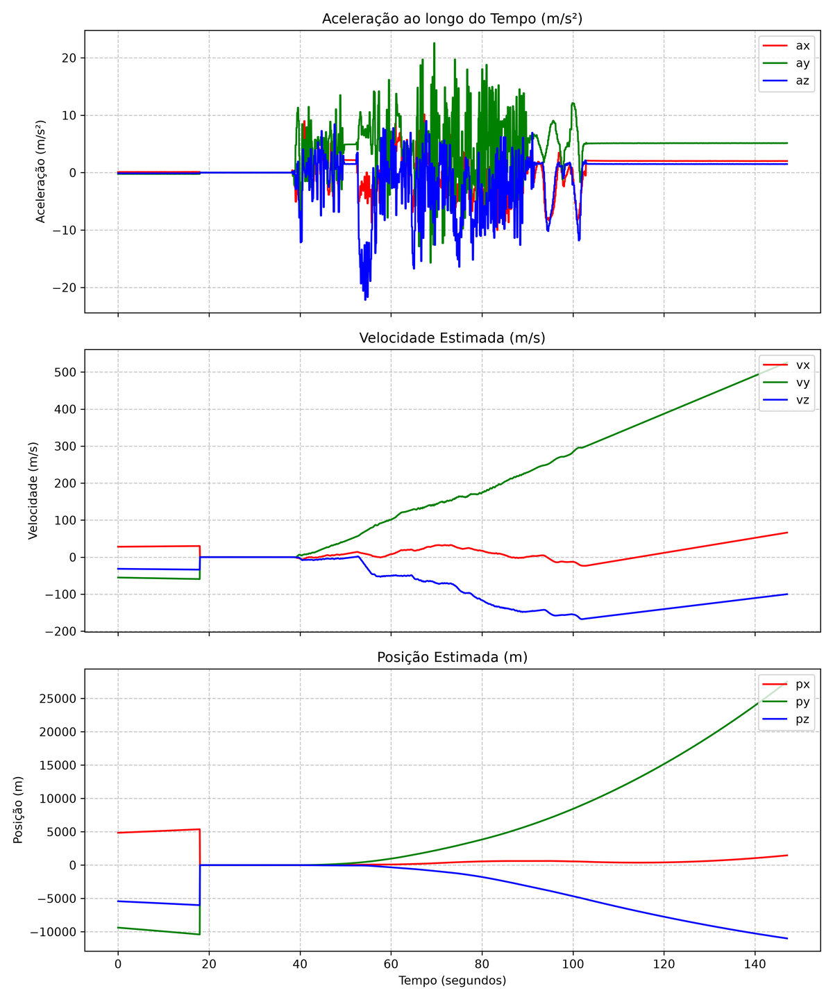

# Relatório de testes: acelerômetro MMA8451Q e envio pela serial (FRDM-KL25Z)

| | |
|---|---|
| **Aluno** | Bernardo Machado |
| **Data dos testes** | 17/11/2026 |
| **Firmware testado** | [`src/main.c`](src/main.c) e [`zephyr/prj.conf`](zephyr/prj.conf), commit [`c0717b7`](https://github.com/bmchad/uc-aula1-fork/commit/c0717b7) |
| **Evidências** | Placa reta: [pasta "Evidências - acelerômetro serial com a placa reta"](https://drive.google.com/drive/folders/1flcUWaX2Dn6TFE0AysnYtmH-tYpR4SXS)<br>Placa inclinada: [pasta "Evidências - acelerômetro serial com a placa inclinada"](https://drive.google.com/drive/folders/1GCFdvzj__6ILhXRF8IEI3-mzo1T6pIw3)<br>Movimento caótico: [pasta "Evidências - acelerômetro serial com movimento caótico"](https://drive.google.com/drive/folders/1pgELpGPy8gRiZqE4TGKtdR3yZLhgbGs6) |
| **Situação** | T0, T1, T4, T5, T6 e T7 concluídos; T2 parcial; T3 pendente ([seção 10](#10-pendências)) |

## 1. Objetivo

A atividade não tem enunciado escrito: foram fornecidos dois scripts Python, `leitor_serial.py` e `gerar_graficos.py`. A partir deles, o objetivo foi interpretado assim: ler o acelerômetro MMA8451Q da FRDM-KL25Z, estimar velocidade e posição por integração numérica, enviar os 9 valores pela serial a cada 50 ms, gravar os dados em CSV no PC e gerar os gráficos de aceleração, velocidade e posição.

## 2. Sistema

### 2.1 Firmware (`src/main.c`, Zephyr 4.2)

- **Leitura:** driver `fxos8700` do Zephyr, que também atende o MMA8451Q, pela I2C0. O driver entrega a aceleração já em m/s². A faixa é a padrão do driver, **±8 g**, com resolução de 0,976 mg/LSB, ou cerca de 0,0096 m/s².
- **Taxa do sensor:** o driver inicializa o sensor a **6,25 Hz**, e o firmware não altera essa taxa. Por isso, cada leitura nova do sensor aparece cerca de 3 vezes seguidas no CSV ([seção 8](#8-análise-deriva-da-posição)).
- **Amostragem do firmware:** a cada 50 ms (20 Hz). O agendamento é absoluto (`k_sleep(K_TIMEOUT_ABS_MS(...))`), então o tempo de processamento não acumula atraso.
- **Calibração:** 2 s com a placa parada logo após o reset. A média desse período é subtraída das leituras seguintes, o que remove a gravidade e o offset. A macro `REMOVER_GRAVIDADE` permite enviar os valores crus.
- **Integração (Euler):** v ← v + a·Δt e p ← p + v·Δt, com Δt = 0,05 s.
- **Saída serial:** 115200 bps. Primeiro o cabeçalho `ax,ay,az,vx,vy,vz,px,py,pz`, depois uma linha por amostra com 3 casas decimais. O `printk` do Zephyr não formata ponto flutuante, então os valores são impressos com aritmética inteira.
- **Configuração (`zephyr/prj.conf`):** `CONFIG_I2C`, `CONFIG_SENSOR`, `CONFIG_FXOS8700` e `CONFIG_FXOS8700_MODE_ACCEL`.

### 2.2 Scripts no PC

- `leitor_serial.py`: a única alteração foi `PORTA_SERIAL`, de `'COM6'` para `'COM15'`. Na máquina de teste, a COM6 é uma porta Bluetooth.
- `gerar_graficos.py`: sem alterações.

## 3. Ambiente de teste

| Item | Versão / valor |
|---|---|
| Placa | FRDM-KL25Z (MKL25Z128VLK4, 48 MHz, 128 KB Flash, 16 KB RAM) |
| RTOS | Zephyr 4.2.0 (PlatformIO, framework-zephyr 3.40200) |
| Compilador | arm-none-eabi-gcc 8.2.1 |
| Gravação | LinkServer (MCUXpresso) pelo OpenSDA/DAPLink |
| Serial | COM15 (USB VID:PID 0D28:0204), 115200 bps |
| PC | Python 3.12.10, pyserial 3.5, pandas, numpy, matplotlib 3.11.2 |

## 4. Plano de testes

| ID | Teste | Procedimento | Resultado esperado | Situação |
|---|---|---|---|---|
| T0 | Build e gravação | `pio run -e frdm_kl25z` e `pio run -e frdm_kl25z -t upload` | Compila sem erros e sem avisos em `main.c`; gravação concluída | **Aprovado** |
| T1 | Repouso, placa reta | Placa reta, parada sobre a mesa. Reset feito pela regravação, sem tocar na placa. Captura de 90 s da serial com o tempo do PC. | Mensagens de boot e calibração; cabeçalho; linhas com 9 campos; 20 Hz; nenhum erro de leitura; aceleração média menor que 0,1 m/s² em cada eixo | **Aprovado** |
| T2 | Escala e eixos | Gravar com `REMOVER_GRAVIDADE 0` e deixar a placa 5 s em cada uma das 6 orientações | O eixo voltado para baixo marca ±9,81 m/s² (erro de até 3%); os outros dois ficam perto de 0 | **Parcial**: a escala foi confirmada pelo T5 (módulo da gravidade de 9,801 m/s², erro de −0,06%); falta verificar cada eixo e seu sinal isoladamente |
| T3 | Movimento conhecido | Deslocar a placa 20 cm em X, guiada por uma régua, e parar | Pulso positivo e depois negativo em ax; vx volta perto de 0; px perto de 0,2 m, com o erro de deriva | Pendente |
| T4 | Scripts do professor | `leitor_serial.py` gravando ao vivo e depois `gerar_graficos.py` | CSV com cabeçalho e PNG com os 3 gráficos | **Aprovado com ressalva**: o `leitor_serial.py` gravou ao vivo no T7 e o `gerar_graficos.py` funcionou em todos os testes. Porém, o leitor grava como cabeçalho a primeira linha com 9 campos que recebe, mesmo que seja um dado ([seção 7](#7-resultados-com-movimento-caótico-t7)). |
| T5 | Placa inclinada, sem recalibrar | Placa calibrada reta e depois inclinada e apoiada, parada. Captura de 30 s sem reset. | A aceleração fica constante e diferente de zero (a gravidade inclinada menos a gravidade reta). Somando de volta a gravidade da calibração, o módulo dá 9,81 m/s² (erro de até 3%). | **Aprovado** |
| T6 | Repouso, placa inclinada | Com a placa inclinada e parada, reset pela regravação (nova calibração já inclinada) e captura de 90 s | O mesmo do T1: a calibração zera a aceleração também na posição inclinada | **Aprovado**, com deriva 5 vezes maior que no T1 ([seção 6.2](#62-t6-repouso-com-a-placa-inclinada-recalibrada)) |
| T7 | Movimento caótico | Placa recalibrada parada (reset pela regravação), depois movida de forma caótica e por fim deixada parada. Gravação feita com o `leitor_serial.py` sem alterações, encerrado após 150 s. | Leitura sem erros durante o movimento, picos dentro da faixa de ±8 g, e a velocidade e a posição divergindo (limitação esperada da integração dupla) | **Aprovado** ([seção 7](#7-resultados-com-movimento-caótico-t7)) |

## 5. Resultados com a placa reta

**Todas as evidências desta seção foram obtidas com a placa reta**, apoiada sobre a mesa com a face dos componentes para cima. Elas estão na [pasta "Evidências - acelerômetro serial com a placa reta"](https://drive.google.com/drive/folders/1flcUWaX2Dn6TFE0AysnYtmH-tYpR4SXS). O firmware do T0 é o mesmo usado em todos os testes, inclusive os da placa inclinada e do movimento caótico.

### 5.1 T0: build e gravação

- Build: **SUCCESS** em 95 s, sem nenhum aviso em `src/main.c`. Flash: 20.808 B (15,9%). RAM: 4.142 B (25,3%).
- Gravação: o LinkServer registrou "Finished writing Flash successfully" e resetou a placa.
- Evidências: [t0_build_platformio.txt](https://drive.google.com/file/d/1XG80h39-4RPNtZ6vKlOx6Oelm2hRhOtw/view) e [t0_gravacao_linkserver.txt](https://drive.google.com/file/d/1dc2kHmRJFqCOoWkdrF2uYMFNALbN2wah/view).

### 5.2 T1: repouso com a placa reta

A captura começou antes da regravação que resetou a placa. Por isso, os primeiros 21,5 s do arquivo `t1_captura_serial.txt` são da execução anterior, ainda com a calibração ruim descrita na [seção 9](#9-problemas-encontrados-e-como-foram-resolvidos). A análise usa só as linhas depois do cabeçalho. Trecho do reset (tempo do PC em segundos):

```text
21.531  *** Booting Zephyr OS build zephyr-v40200 ***
21.531  Calibrando: mantenha a placa parada por 2000 ms...
23.531  Calibracao concluida
23.531  ax,ay,az,vx,vy,vz,px,py,pz
23.547  0.001,0.004,0.003,0.000,0.000,0.000,0.000,0.000,0.000
```

| Medida | Resultado | Esperado | OK |
|---|---|---|---|
| Calibração | 2,000 s entre o início e "Calibracao concluida" | 2 s | Sim |
| Amostras | 1330 em 66,45 s (saída serial a 20,00 Hz; o sensor em si atualiza a 6,25 Hz, seção 8) | 20 Hz | Sim |
| Tempo da placa (amostras × 50 ms) | 66,45 s, igual ao relógio do PC | sem atraso acumulado | Sim |
| Linhas "# erro de leitura" | 0 | 0 | Sim |
| ax: média / desvio | −0,0015 / 0,0063 m/s² | \|média\| < 0,1 m/s² | Sim |
| ay: média / desvio | −0,0025 / 0,0062 m/s² | \|média\| < 0,1 m/s² | Sim |
| az: média / desvio | +0,0008 / 0,0062 m/s² | \|média\| < 0,1 m/s² | Sim |

Velocidade e posição estimadas com a placa parada:

| Tempo | v (m/s): x, y, z | p (m): x, y, z |
|---|---|---|
| 0 s | 0,000; 0,000; 0,000 | 0,000; 0,000; 0,000 |
| 10 s | −0,008; −0,029; +0,015 | −0,057; −0,186; +0,036 |
| 20 s | −0,027; −0,040; +0,012 | −0,197; −0,522; +0,221 |
| 30 s | −0,069; −0,066; +0,011 | −0,662; −1,068; +0,351 |
| 40 s | −0,091; −0,101; +0,003 | −1,479; −1,939; +0,373 |
| 50 s | −0,120; −0,112; +0,023 | −2,539; −2,997; +0,495 |
| 60 s | −0,113; −0,150; +0,046 | −3,689; −4,311; +0,849 |
| 66,45 s (fim) | −0,106; −0,166; +0,048 | −4,405; −5,329; +1,157 |

**Figura 1.** Gráficos gerados pelo `gerar_graficos.py` com os dados do T1 (placa reta e parada). [Original em resolução cheia](https://drive.google.com/file/d/1-XsmYwFlsfpJ-Iinvp_KYGLFfPx_S0F2/view).



### 5.3 T4: gerar_graficos.py

O CSV montado a partir da captura do T1 (cabeçalho mais 1330 linhas) foi lido pelo `gerar_graficos.py` sem alterações no script, e a Figura 1 foi gerada. O eixo de tempo do script, que assume 50 ms por amostra, vai de 0 a 66,45 s e confere com o tempo medido no PC.

## 6. Resultados com a placa inclinada

Depois do T1, a placa foi inclinada e deixada apoiada e parada. **Todas as evidências desta seção foram obtidas com a placa inclinada** e estão na [pasta "Evidências - acelerômetro serial com a placa inclinada"](https://drive.google.com/drive/folders/1GCFdvzj__6ILhXRF8IEI3-mzo1T6pIw3). A inclinação foi medida pelo próprio acelerômetro (seção 6.1): cerca de 30°.

### 6.1 T5: placa inclinada sem recalibrar

A placa continuava com a calibração feita reta no T1, então o firmware seguia subtraindo a gravidade da posição reta, g<sub>reta</sub> = (0; 0; +9,81) m/s². Com a placa inclinada, a leitura passa a ser a = g<sub>inclinada</sub> − g<sub>reta</sub>. Assim, a gravidade na posição inclinada pode ser recuperada como g<sub>inclinada</sub> = a + g<sub>reta</sub>.

| Medida | Resultado | Esperado | OK |
|---|---|---|---|
| Amostras | 600 em 30 s (20 Hz) | 20 Hz | Sim |
| ax: média / desvio | −1,3136 / 0,0073 m/s² | constante, diferente de 0 | Sim |
| ay: média / desvio | −4,7676 / 0,0067 m/s² | constante, diferente de 0 | Sim |
| az: média / desvio | −1,3445 / 0,0074 m/s² | constante, diferente de 0 | Sim |
| Gravidade reconstruída | (−1,314; −4,768; +8,462) m/s² | — | — |
| Módulo da gravidade | 9,801 m/s² (referência 9,807; erro de −0,06%) | 9,81 m/s² ± 3% | Sim |
| Inclinação em relação à vertical | 30,3° | — | — |
| Direção da inclinação no plano XY | −105° a partir de +X (quase toda no sentido −Y) | — | — |

O módulo confere com a gravidade, com erro de −0,06%, o que valida a escala do sensor (parte do T2). O sinal também foi confirmado: se o eixo Z lesse −9,81 m/s² com a placa reta, o módulo daria 12,2 m/s², incompatível com a gravidade. O cálculo assume que a mesa estava nivelada no T1.

A velocidade e a posição, por outro lado, perdem o sentido, porque o firmware integra os −4,77 m/s² de ay como se fossem movimento. No início desta captura, vy já estava em −1165 m/s e py em −155 km (Figura 2). **A calibração só vale para a orientação em que foi feita.**

**Figura 2.** T5: placa inclinada sem recalibrar. [Original em resolução cheia](https://drive.google.com/file/d/14tf0cs0tJzQ3Q8zDqz1Tf_wDOs4gdyrr/view).



### 6.2 T6: repouso com a placa inclinada (recalibrada)

Com a placa ainda inclinada e parada, ela foi resetada pela regravação, e a calibração foi refeita já na posição inclinada. Como no T1, os primeiros 22 s do arquivo de captura são da execução anterior (a do T5). Trecho do reset:

```text
22.047  *** Booting Zephyr OS build zephyr-v40200 ***
22.047  Calibrando: mantenha a placa parada por 2000 ms...
24.047  Calibracao concluida
24.047  ax,ay,az,vx,vy,vz,px,py,pz
```

| Medida | Resultado | Esperado | OK |
|---|---|---|---|
| Calibração | 2,000 s | 2 s | Sim |
| Amostras | 1320 em 65,95 s (20,00 Hz) | 20 Hz | Sim |
| Tempo da placa (amostras × 50 ms) | 65,95 s, igual ao relógio do PC | sem atraso acumulado | Sim |
| Linhas "# erro de leitura" | 0 | 0 | Sim |
| ax: média / desvio | +0,0067 / 0,0060 m/s² | \|média\| < 0,1 m/s² | Sim |
| ay: média / desvio | −0,0134 / 0,0068 m/s² | \|média\| < 0,1 m/s² | Sim |
| az: média / desvio | −0,0101 / 0,0075 m/s² | \|média\| < 0,1 m/s² | Sim |
| Fim da captura | v = (+0,437; −0,888; −0,681) m/s<br>p = (+15,513; −28,170; −20,656) m | — | — |

A recalibração voltou a zerar a aceleração: o resíduo ficou cerca de 280 vezes menor que no T5. Mesmo assim, ele ficou cerca de 6 vezes maior que no T1, e a posição derivou 28 m em 66 s, contra 5 m com a placa reta (Figura 3).

Médias da aceleração em janelas de 10 s, comparadas com o T1 (m/s²):

| Janela | T6 inclinada: ay | T6 inclinada: az | T1 reta: ay | T1 reta: az |
|---|---|---|---|---|
| 0 a 10 s | −0,0123 | −0,0076 | −0,0030 | +0,0016 |
| 10 a 20 s | −0,0127 | −0,0088 | −0,0010 | −0,0001 |
| 20 a 30 s | −0,0128 | −0,0106 | −0,0025 | +0,0000 |
| 30 a 40 s | −0,0139 | −0,0096 | −0,0036 | −0,0006 |
| 40 a 50 s | −0,0127 | −0,0120 | −0,0011 | +0,0021 |
| 50 a 60 s | −0,0146 | −0,0112 | −0,0036 | +0,0024 |
| 60 a 66 s | −0,0160 | −0,0120 | −0,0026 | +0,0003 |

No T6, o resíduo já existe na primeira janela e cresce devagar. No T1, as médias oscilam em torno de zero, sem tendência. A explicação mais provável é a placa ter se acomodado no apoio inclinado: um pequeno deslocamento logo depois da calibração e depois um escorregamento lento. Uma rotação de dθ muda a gravidade medida em cerca de g·dθ, então o resíduo de 0,018 m/s² corresponde a uma variação de inclinação de apenas **~0,1°** (0,018 / 9,81 rad). Essa hipótese não foi confirmada por medição independente.

**Figura 3.** T6: placa inclinada e recalibrada. [Original em resolução cheia](https://drive.google.com/file/d/1wto6pNgTqZaYFhiSHwcWnZiddwG5wl_K/view).



### 6.3 Comparação entre as posições

| Medida | T1: reta | T5: inclinada, sem recalibrar | T6: inclinada, recalibrada |
|---|---|---|---|
| Aceleração média (módulo) | 0,003 m/s² | 5,13 m/s² | 0,018 m/s² |
| Ruído (desvio por eixo) | ~0,006 m/s² | ~0,007 m/s² | ~0,007 m/s² |
| Velocidade após 60 s (módulo) | 0,19 m/s | sem sentido físico | 1,08 m/s |
| Posição após 60 s (módulo) | 5,7 m | sem sentido físico | 31,5 m |

- O **ruído** do sensor é praticamente o mesmo nas três situações: ele não depende da orientação.
- O que muda é o **offset**. Inclinar a placa depois da calibração gera um offset de metros por segundo ao quadrado (T5). Recalibrar remove esse offset, mas qualquer variação de inclinação de décimos de grau depois da calibração volta a aparecer (T6).

## 7. Resultados com movimento caótico (T7)

**Todas as evidências desta seção foram obtidas com a placa em movimento caótico** e estão na [pasta "Evidências - acelerômetro serial com movimento caótico"](https://drive.google.com/drive/folders/1pgELpGPy8gRiZqE4TGKtdR3yZLhgbGs6). A placa foi resetada pela regravação enquanto estava parada, e só depois foi movida. A gravação foi feita pelo próprio `leitor_serial.py`, sem alterações. Ele rodou por 150 s e foi encerrado pelo mesmo sinal que o Ctrl+C envia.

### 7.1 Gravação ao vivo com o leitor_serial.py (T4)

- **Funcionou de ponta a ponta:** o leitor conectou na COM15, gravou 2943 linhas no CSV, imprimiu "Leitura encerrada pelo usuário" e fechou a porta.
- **Defeito encontrado:** o leitor grava como cabeçalho a primeira linha com 9 campos que recebe, sem conferir o conteúdo. Quando ele abriu a porta, a placa ainda estava transmitindo a execução anterior ao reset. Por isso, a "linha de cabeçalho" do CSV é um dado, as linhas 1 a 360 (18 s) são da execução antiga, e o cabeçalho verdadeiro (`ax,ay,az,...`) ficou gravado como dado na linha 361.
- **Efeito no gráfico:** o `gerar_graficos.py` descarta a linha `ax,...`, porque ela não é numérica, mas plota as 360 linhas antigas. A Figura 5 mostra isso: os primeiros 18 s exibem velocidade e posição da execução antiga, com um salto para zero no reset, e todo o resto fica deslocado em 18 s.
- **Como foi tratado:** a análise usa só as linhas a partir do cabeçalho verdadeiro (`dados_cinematicos_limpo.csv`, Figura 4). O CSV bruto foi mantido como evidência.

### 7.2 Resultados

| Medida | Resultado |
|---|---|
| Amostras da execução nova | 2582, ou seja, 129,1 s a 50 ms por amostra. É compatível com o tempo de gravação que restava depois do reset, então não houve perda de linhas. |
| Repouso antes do movimento (0 a 19 s) | \|a\| médio de 0,004 m/s², desvio de cerca de 0,007 m/s² |
| Movimento detectado | De 20,0 s a 85,0 s (65 s). Critério: desvio de \|a\| em 1 s maior que 0,2 m/s². O trecho pode incluir o manuseio para pegar e soltar a placa. |
| Picos de aceleração | ax de −10,0 a +10,1; ay de −15,7 a +22,6; az de −22,2 a +9,0 m/s². \|a\| máximo: 23,9 m/s² (2,4 g). |
| Saturação | Não houve: os picos ficaram bem abaixo do limite de ±8 g (±78 m/s²) |
| Repouso depois do movimento (86 a 129 s) | a média = (+2,03; +5,13; +1,49) m/s², com \|a\| = 5,71 m/s² e desvio de cerca de 0,01 m/s² |
| Fim do movimento (85 s) | \|v\| = 344 m/s; \|p\| = 10,6 km |
| Fim da gravação (129 s) | \|v\| = 540 m/s; \|p\| = 29,7 km |
| Taxa real do sensor | 415 leituras distintas em 1300 amostras (65 s de movimento): 6,38 Hz, com cada leitura repetida 3 ou 4 vezes no CSV |

**Figura 4.** T7 com o CSV limpo (a partir do cabeçalho verdadeiro). [Original em resolução cheia](https://drive.google.com/file/d/1Wgy-nr6oqG-A4DGXxkAYySfx7uZfSCJS/view).



**Figura 5.** T7 com o CSV bruto do `leitor_serial.py`, como o `gerar_graficos.py` o plota sem tratamento. [Original em resolução cheia](https://drive.google.com/file/d/1yU-Em2A3hpx2NofadhAoF-T04KcqHJud/view).



### 7.3 Interpretação

- **A medição de aceleração funcionou:** a leitura seguiu durante todo o movimento, os picos de 2,4 g ficaram dentro da faixa, e o ruído em repouso antes e depois do movimento é o mesmo dos outros testes.
- **A placa terminou em outra orientação:** depois do movimento, a placa ficou parada com \|a\| = 5,71 m/s², como no T5. Ela terminou numa orientação diferente da calibração. O mesmo patamar aparece entre 31 e 35 s, então a placa foi colocada duas vezes na mesma posição. Se a calibração foi feita na mesma posição inclinada do T5, a gravidade final reconstruída é (0,71; 0,36; 9,96) m/s², o que indica a placa quase reta (~5°). O módulo dá 9,99 m/s², 1,8% acima do esperado, o que indica que a posição de calibração não era exatamente a do T5. Essa estimativa é aproximada.
- **A velocidade e a posição não têm sentido físico** (540 m/s e 30 km). Há três causas somadas:
  1. **A gravidade "vaza"** a cada orientação diferente da calibração. Essa é a causa dominante: só no repouso final, 5,71 m/s² durante 44 s somam cerca de 250 m/s.
  2. **O sensor atualiza a só 6,25 Hz.** Movimentos de mão acima de ~3 Hz ficam distorcidos (aliasing).
  3. **A integração dupla** acumula o ruído e o offset.
- **Conclusão do T7:** o sistema mede bem a aceleração, inclusive a orientação, pela gravidade. Mas estimar a posição por integração dupla não funciona nem por um minuto com a placa em movimento.

## 8. Análise: deriva da posição

- **Ruído e offset:** com a placa parada, a aceleração tem ruído de cerca de 0,006 m/s² e média residual de até 0,0025 m/s². Na faixa padrão do driver (±8 g), 1 LSB vale 0,976 mg, cerca de 0,0096 m/s². Por isso, na Figura 1, a aceleração aparece em degraus discretos desse tamanho. O resíduo médio é menor que 1 LSB e compatível com o erro estatístico da calibração: em 2 s, com o sensor a 6,25 Hz, há só cerca de 12 leituras distintas, e 0,006 / √12 ≈ 0,0017 m/s².
- **Taxa de amostragem:** o driver inicializa o sensor a 6,25 Hz, e o firmware lê a cada 50 ms. Por isso, cada leitura aparece cerca de 3 vezes seguidas no CSV (6,38 Hz efetivos medidos no T7). Em repouso isso pouco importa, mas em movimento só componentes abaixo de ~3 Hz (limite de Nyquist) são registrados sem distorção. Correção proposta, não aplicada nos testes: no início do firmware, chamar `sensor_attr_set(acel, SENSOR_CHAN_ALL, SENSOR_ATTR_SAMPLING_FREQUENCY, &taxa)` com taxa de 50 Hz ou mais, e ler o sensor na mesma frequência.
- **Como o erro cresce:** um erro constante *e* na aceleração vira um erro de velocidade *e·t* e um erro de posição *½·e·t²*. Para e = 0,0025 m/s² e t = 66,45 s, ½ × 0,0025 × 66,45² ≈ 5,5 m, próximo dos 5,3 m medidos em py.
- **Orientação:** a calibração só vale para a orientação em que foi feita. Inclinar a placa depois dela gera um offset de vários m/s² (T5). Mesmo recalibrando, uma variação de inclinação de ~0,1° depois da calibração já basta para multiplicar a deriva por 5 (T6).
- **Conclusão:** integrar duas vezes a leitura de um acelerômetro sozinho faz a posição perder a utilidade em poucos segundos. Com a placa reta e parada, já são 0,19 m em 10 s; com a placa inclinada, 0,9 m em 10 s; com movimento, a estimativa perde o sentido físico (T7). Uma calibração mais longa ajuda só em parte: calibrar por 10 s em vez de 2 s reduziria o erro da média cerca de √5 ≈ 2,2 vezes, mas a posição continuaria crescendo com t². Variações de décimos de grau na inclinação já anulam esse ganho.
- **Mitigações possíveis (não implementadas):** zerar a velocidade quando a placa for detectada parada (ZUPT), aplicar um filtro passa-alta na velocidade, ou combinar o acelerômetro com outro sensor que meça posição.

## 9. Problemas encontrados e como foram resolvidos

| Problema | Causa | Solução |
|---|---|---|
| A COM6 do `leitor_serial.py` não era a placa | Na máquina de teste, as portas COM3, 4, 5, 6, 13 e 14 são Bluetooth; a placa aparece como COM15 | `PORTA_SERIAL` trocada para `'COM15'` |
| COM15 com "Acesso negado", mesmo após reconectar a placa | A porta estava aberta por um monitor serial de outro projeto, que usa a mesma placa. No Windows, uma porta COM só pode ser aberta por um programa de cada vez. | Monitor do outro projeto fechado |
| Velocidade já em cerca de −1,3 m/s em z antes do T1 (início do arquivo `t1_captura_serial.txt`), com a placa parada | A calibração rodou ao reconectar o cabo, com a placa na mão, e integrou esse movimento como se fosse offset | No T1, o reset foi feito pela regravação, sem tocar na placa |
| Erro "CreateProcess: No such file or directory" ao montar o código, em 16/11 | Não confirmada. O assembler (`as.exe`) existia e rodava sozinho. A hipótese é um bloqueio temporário pelo Smart App Control do Windows. | Não se repetiu em 17/11; o build do T0 passou sem alterações |
| O `leitor_serial.py` gravou um dado como cabeçalho (T7) | O script considera cabeçalho a primeira linha com 9 campos que recebe. Como a placa já transmitia quando a porta foi aberta, essa linha era um dado da execução anterior. | A análise usou só as linhas a partir do cabeçalho verdadeiro (linha 361). Correção sugerida no script: aceitar como cabeçalho só a linha `ax,ay,az,vx,vy,vz,px,py,pz` e descartar o que vier antes dela. |
| Valores de aceleração repetidos 3 ou 4 vezes seguidas no CSV | O driver inicializa o sensor a 6,25 Hz, e o firmware lê a 20 Hz | Não corrigido durante os testes. Correção proposta na seção 8: configurar o sensor para 50 Hz ou mais com `sensor_attr_set`. |

## 10. Pendências

- **T2:** a escala já foi confirmada pelo T5. Falta verificar cada eixo e o seu sinal isoladamente, com `REMOVER_GRAVIDADE 0` e a placa em cada uma das 6 orientações.
- **T3:** movimento conhecido de 20 cm, para medir o erro da posição estimada.
- **Taxa do sensor:** configurar o sensor para 50 Hz ou mais e repetir o T7, para comparar.
- **Leitor:** corrigir a detecção de cabeçalho do `leitor_serial.py` (sugestão na [seção 9](#9-problemas-encontrados-e-como-foram-resolvidos)).

## Anexos

### Placa reta ([pasta](https://drive.google.com/drive/folders/1flcUWaX2Dn6TFE0AysnYtmH-tYpR4SXS))

| Arquivo | Conteúdo |
|---|---|
| [t0_build_platformio.txt](https://drive.google.com/file/d/1XG80h39-4RPNtZ6vKlOx6Oelm2hRhOtw/view) | Log completo do build (T0) |
| [t0_gravacao_linkserver.txt](https://drive.google.com/file/d/1dc2kHmRJFqCOoWkdrF2uYMFNALbN2wah/view) | Log da gravação pelo LinkServer (T0) |
| [t1_captura_serial.txt](https://drive.google.com/file/d/1rnqgHSW8-LKRge1g-PgHvrUELmGe5Q2B/view) | Tudo o que a placa enviou durante a captura do T1, com o tempo do PC em cada linha. Os primeiros 21,5 s são da execução anterior ao reset. |
| [t1_dados_cinematicos.csv](https://drive.google.com/file/d/17xFFWcxEig4ccFMSsThOU266Wu1kU5ft/view) | CSV no formato do `leitor_serial.py`, montado com as linhas a partir do cabeçalho |
| [t1_analise.txt](https://drive.google.com/file/d/1uAKtEDZGk2u5JjJOdOWBXZbvSJaWFh0w/view) | Saída do script de análise (taxa, médias, desvios, deriva) |
| [t1_graficos_atividade2.png](https://drive.google.com/file/d/1-XsmYwFlsfpJ-Iinvp_KYGLFfPx_S0F2/view) | Figura 1 em resolução cheia |

### Placa inclinada ([pasta](https://drive.google.com/drive/folders/1GCFdvzj__6ILhXRF8IEI3-mzo1T6pIw3))

| Arquivo | Conteúdo |
|---|---|
| [a_sem_recalibrar_captura_serial.txt](https://drive.google.com/file/d/16v-G8mT2CsC-HoA_fqlxTTydg08tF5uw/view) | T5: tudo o que a placa enviou em 30 s, com o tempo do PC em cada linha |
| [a_sem_recalibrar_dados_cinematicos.csv](https://drive.google.com/file/d/14azt5IOgglnGGPczco104om5zAsEbtLs/view) | T5: CSV no formato do `leitor_serial.py`. O cabeçalho foi acrescentado porque a captura começou com a placa já em execução. |
| [a_sem_recalibrar_analise.txt](https://drive.google.com/file/d/11Ecb9SECnEuam6fBkTjs5EM1KlCiinPG/view) | T5: médias, gravidade reconstruída, módulo e ângulo de inclinação |
| [a_sem_recalibrar_graficos.png](https://drive.google.com/file/d/14tf0cs0tJzQ3Q8zDqz1Tf_wDOs4gdyrr/view) | Figura 2 em resolução cheia |
| [b_gravacao_linkserver.txt](https://drive.google.com/file/d/1w9X6Ojpy84RxCk2K6tK5bplxZvcG2Gcb/view) | T6: log da regravação usada para resetar a placa sem tocá-la |
| [b_recalibrada_captura_serial.txt](https://drive.google.com/file/d/1LIEsm0ARaHm9Ltih2AFaRtlmhhAV_Ufm/view) | T6: tudo o que a placa enviou em 90 s. Os primeiros 22 s são da execução anterior ao reset (T5). |
| [b_recalibrada_dados_cinematicos.csv](https://drive.google.com/file/d/1KrjGMMU8rVYyNR2R_CCCSPVLIXpYkeuE/view) | T6: CSV montado com as linhas a partir do cabeçalho |
| [b_recalibrada_analise.txt](https://drive.google.com/file/d/1NjfNCwNGdOhz4gJUfAmiqEkaVAClllG8/view) | T6: taxa, médias, desvios e deriva |
| [b_recalibrada_graficos.png](https://drive.google.com/file/d/1wto6pNgTqZaYFhiSHwcWnZiddwG5wl_K/view) | Figura 3 em resolução cheia |

### Movimento caótico ([pasta](https://drive.google.com/drive/folders/1pgELpGPy8gRiZqE4TGKtdR3yZLhgbGs6))

| Arquivo | Conteúdo |
|---|---|
| [gravacao_linkserver.txt](https://drive.google.com/file/d/1GTAGFb2b3f2HbKipWXcsAkIuWZmz7Rnh/view) | Log da regravação usada para resetar a placa sem tocá-la |
| [leitor_csv_bruto.csv](https://drive.google.com/file/d/1KM9JfnvoQ2pyYbxeH_aqaNm_bBg-gucF/view) | CSV exatamente como o `leitor_serial.py` gravou, com o defeito do cabeçalho (seção 7.1) |
| [leitor_saida_terminal.txt](https://drive.google.com/file/d/1zlikJqKgT1Ks3NesRr22aJ3ljlXXBo1-/view) | Tudo o que o `leitor_serial.py` imprimiu, do "Conectado na porta COM15" ao "Porta serial fechada" |
| [dados_cinematicos_limpo.csv](https://drive.google.com/file/d/1PpPzEpUmri-vdKxNeJWBI1KMXLI_TzJG/view) | O mesmo CSV a partir do cabeçalho verdadeiro (linha 361), usado na análise |
| [analise.txt](https://drive.google.com/file/d/1YI4VpY6Rp4dKFLlJGUQbNhY01Os46u2u/view) | Trecho com movimento, picos, repousos, velocidade e posição, e a taxa real do sensor |
| [graficos_csv_limpo.png](https://drive.google.com/file/d/1Wgy-nr6oqG-A4DGXxkAYySfx7uZfSCJS/view) | Figura 4 em resolução cheia |
| [graficos_csv_bruto.png](https://drive.google.com/file/d/1yU-Em2A3hpx2NofadhAoF-T04KcqHJud/view) | Figura 5 em resolução cheia |

O relatório também está em Google Doc, com as figuras em resolução cheia: [Relatório de testes - Acelerômetro MMA8451Q e serial](https://docs.google.com/document/d/1lpKsHSHEk6Vm3HOG22FYEw_zV6wJHb9ipI3xOA6bP_o/edit).
