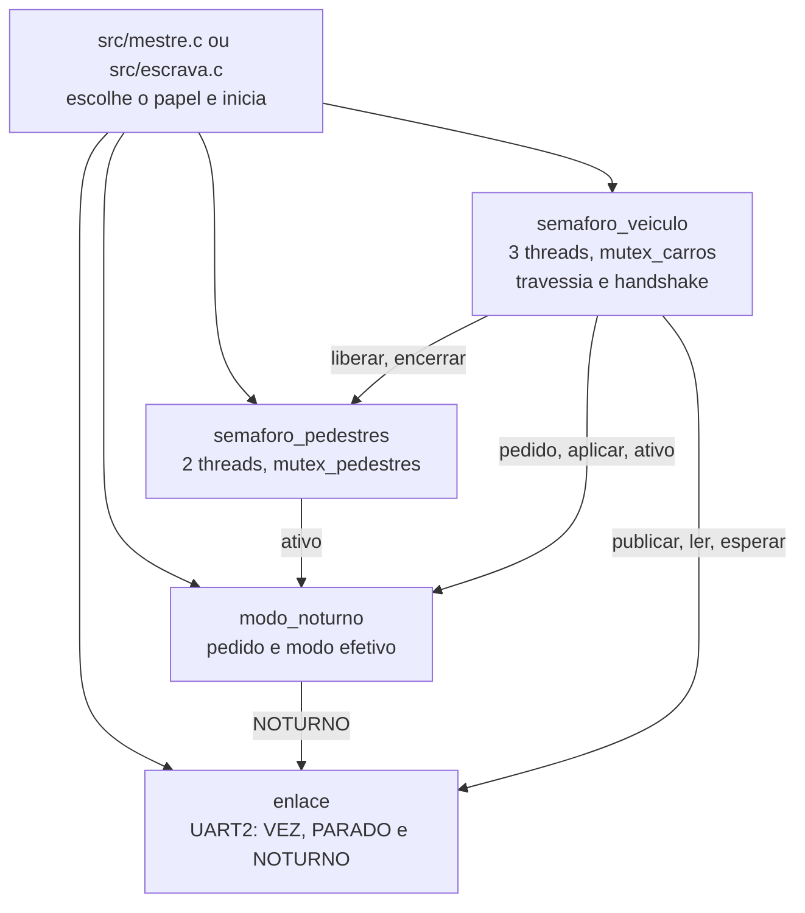
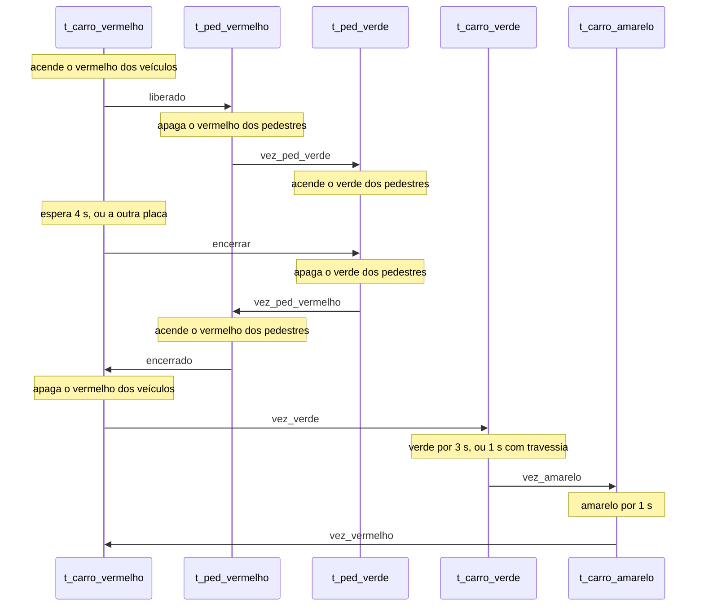
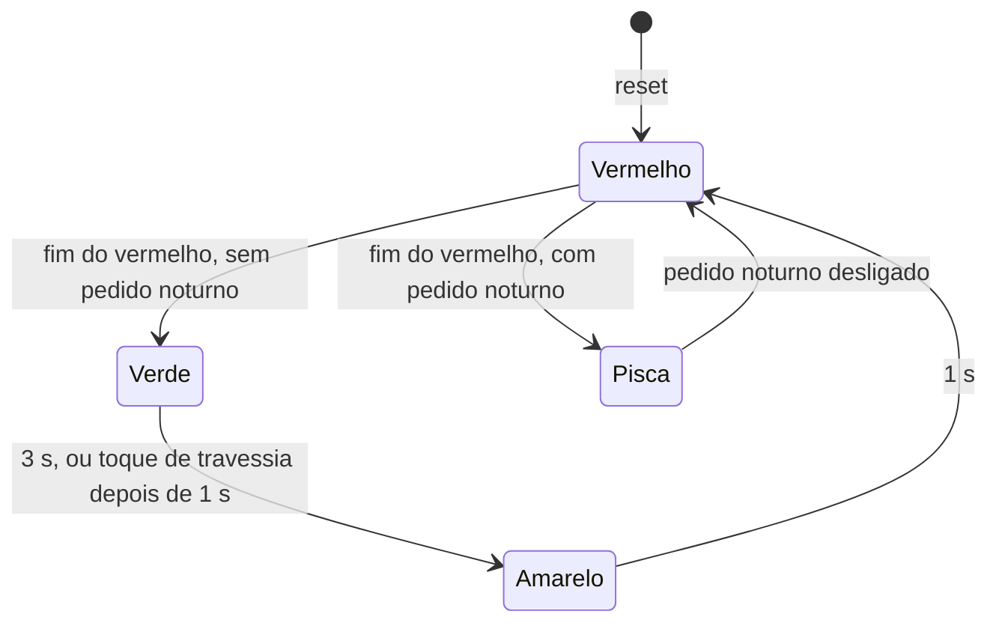
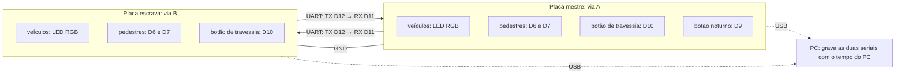
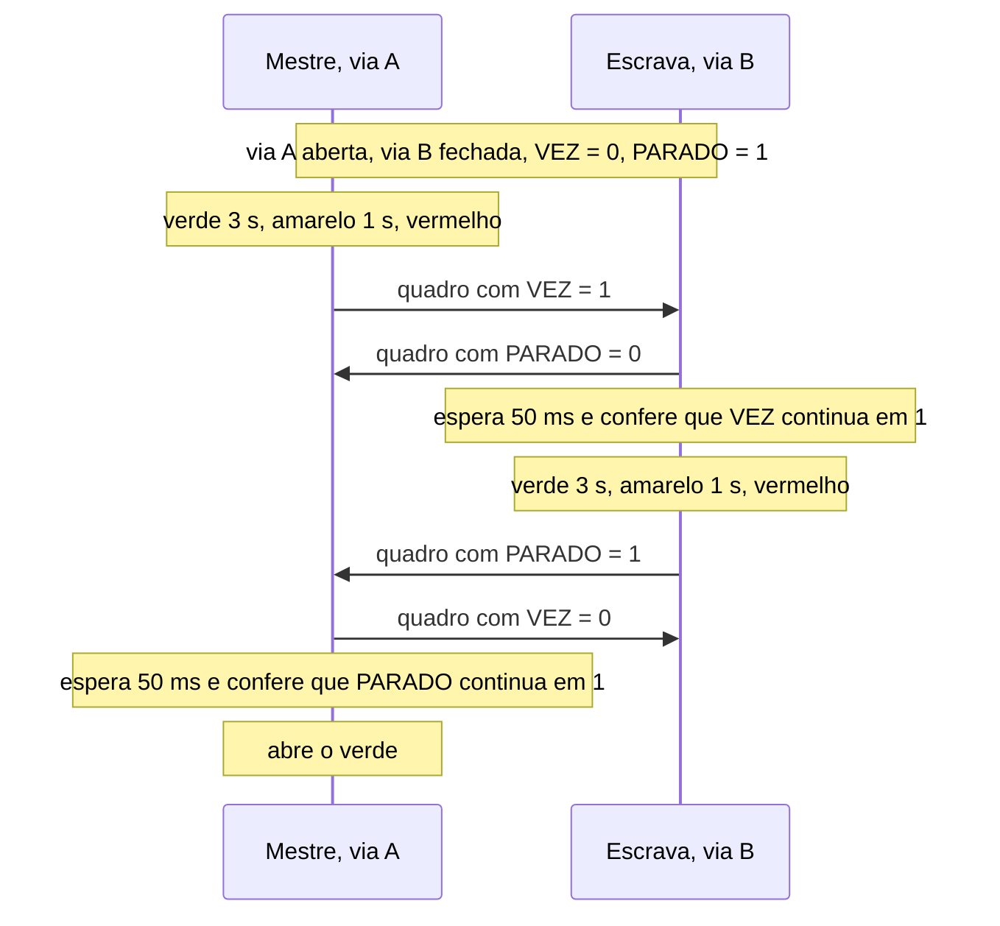

## 1. Arquitetura do firmware

As duas placas rodam as mesmas quatro bibliotecas, em `lib/`. O que muda entre elas é o arquivo principal: `src/mestre.c` ou `src/escrava.c`. Ele só escolhe o papel da placa e inicia as bibliotecas na ordem certa.

### 1.1 Módulos



| Módulo | Responsabilidade | Interface pública |
|---|---|---|
| `lib/enlace` | Comunicação com a outra placa pela UART2. Manda o estado desta placa num quadro de 4 bytes, logo que ele muda e a cada 50 ms, e guarda o estado da outra placa a partir dos quadros válidos. O significado depende do papel: o mestre manda VEZ e NOTURNO; a escrava manda PARADO. Sem quadro válido por 200 ms, os sinais da outra placa valem 0. Na placa única, a UART não é usada. | `enlace_iniciar`, `enlace_sou_mestre`, `enlace_uma_placa`, `enlace_publicar`, `enlace_ler`, `enlace_esperar`, `enlace_aguardar_mudanca`, `enlace_publicar_noturno`, `enlace_ler_noturno` |
| `lib/modo_noturno` | Separa o **pedido** do **modo efetivo**. O pedido vem do botão, no mestre, ou do bit NOTURNO do enlace, na escrava. O modo efetivo só muda quando o semáforo de veículos chega ao ponto seguro. Tem a thread do botão, com debounce. | `modo_noturno_iniciar`, `modo_noturno_pedido`, `modo_noturno_aplicar`, `modo_noturno_ativo` |
| `lib/semaforo_pedestres` | Threads do vermelho e do verde dos pedestres. Não decide nada sozinho: abre quando os veículos liberam e fecha quando os veículos pedem. | `semaforo_pedestres_iniciar`, `semaforo_pedestres_liberar`, `semaforo_pedestres_encerrar` |
| `lib/semaforo_veiculo` | Threads do verde, do amarelo e do vermelho dos veículos. É o centro da placa: comanda os pedestres, atende o botão de travessia, decide o ponto seguro do modo noturno e faz o handshake com a outra placa. | `semaforo_veiculo_iniciar` |
| `src/mestre.c`, `src/escrava.c` | Escolhem o papel e iniciam as bibliotecas. | — |

**Ordem de inicialização:** `enlace` → `modo_noturno` → `semaforo_pedestres` → `semaforo_veiculo`. Todas as threads são criadas com `K_THREAD_DEFINE` e começam bloqueadas num `k_sem`, então nenhuma luz acende antes da inicialização. O `semaforo_pedestres_iniciar` acende o vermelho dos pedestres. O `semaforo_veiculo` vem por último porque é ele que começa o ciclo, pelo vermelho dos veículos (RF-06).

### 1.2 Threads

| Thread | Módulo | Prioridade | Controla | Espera por |
|---|---|---|---|---|
| `t_carro_verde` | `semaforo_veiculo` | 5 | Verde dos veículos (PTB19) | `vez_verde`; depois, o toque de travessia ou o fim dos 3 s |
| `t_carro_amarelo` | `semaforo_veiculo` | 5 | Amarelo dos veículos (PTB18 + PTB19) | `vez_amarelo` |
| `t_carro_vermelho` | `semaforo_veiculo` | 5 | Vermelho dos veículos (PTB18) | `vez_vermelho`; depois, os 4 s ou a outra placa; por fim, `encerrado` |
| `t_ped_vermelho` | `semaforo_pedestres` | 5 | Vermelho dos pedestres (D6) | `vez_ped_vermelho`; depois, `liberado` |
| `t_ped_verde` | `semaforo_pedestres` | 5 | Verde dos pedestres (D7) | `vez_ped_verde`; depois, `encerrar` |
| Thread do botão noturno | `modo_noturno` | 4 | — | Toque no botão. Na escrava fica bloqueada para sempre, porque a interrupção do botão não é instalada. |
| `t_registro_travessia` | `semaforo_veiculo` | 5 | — | Toque no botão de travessia. Só registra o toque na serial (RNF-04); quem age no ciclo é a `t_carro_verde`. |
| `t_enlace_rx` | `enlace` | 5 | — | Bytes recebidos pela UART2. Monta os quadros, descarta os inválidos e avisa quem espera a outra placa. Não roda na placa única. |
| `t_enlace_tx` | `enlace` | 5 | — | Mudança no estado desta placa, ou 50 ms. Manda o quadro pela UART2. Não roda na placa única. |

- **Uma thread por luz (RNF-01):** o amarelo conta como uma luz só. Ele usa os dois pinos do LED RGB, mas é comandado só pela `t_carro_amarelo`.
- **Prioridade do botão:** a thread do botão noturno fica acima das threads das luzes para registrar o toque logo, mesmo com as luzes trocando.
- **Prioridade do registro da travessia e do enlace:** a `t_registro_travessia`, a `t_enlace_rx` e a `t_enlace_tx` ficam na mesma prioridade das luzes. Assim nenhuma das duas interrompe a outra no meio de uma linha da serial, e as linhas não se misturam. O custo é o registro do toque poder atrasar alguns milissegundos.

### 1.3 Sincronização dentro da placa

São três mecanismos, cada um com um papel:

| Mecanismo | Para quê | Requisito |
|---|---|---|
| Um `k_mutex` por semáforo (`mutex_carros`, `mutex_pedestres`) | Cada thread trava o mutex do seu semáforo antes de acender a luz e só destrava depois de apagá-la. Assim, duas luzes do mesmo semáforo nunca ficam acesas juntas. | RS-02, RNF-02 |
| Cadeia de `k_sem` | Dá a ordem entre as luzes. Cada thread, ao terminar, dá o `k_sem_give` da próxima. | RF-03, RF-04, RF-05 |
| Interrupções curtas, sem mutex e sem espera | As interrupções dos dois botões só dão `k_sem_give`; a do botão de travessia acorda duas threads, a `t_carro_verde` e a `t_registro_travessia`. A interrupção da UART2 só copia cada byte recebido para uma fila (`k_msgq_put` sem espera), e a `t_enlace_rx` faz o resto. Quem decide é sempre uma thread. | RNF-03 |

Um terceiro mutex, `mutex_modo`, protege o pedido e o modo efetivo do modo noturno, que são lidos pelas threads das luzes e escritos pela thread do botão.

**Um ciclo, na ordem dos sinais:**



**Por que o RS-01 vale por construção, e não por tempo:**
- O verde dos pedestres só acende depois de `liberado`, e `liberado` só é dado com o vermelho dos veículos já aceso.
- O vermelho dos veículos só apaga depois de `encerrado`, e `encerrado` só é dado com o vermelho dos pedestres já aceso.

Entre um passo e outro há um instante com os dois semáforos no vermelho, que o RS-03 permite. No teste T3 da etapa 1, esse instante durou de 2 a 3 ms.

### 1.4 Modos de operação

O estado da placa é o estado do semáforo de veículos. Os pedestres acompanham pela cadeia da seção 1.3.



**Modo normal:** o ciclo da seção 1.3.

**Travessia:** não é um modo à parte, só encurta o verde dos veículos.
- A interrupção do botão dá `k_sem_give(&pedido_travessia)`. A `t_carro_verde` espera esse sinal depois do 1 s mínimo do verde (RF-08) e, se ele chegar, encerra o verde (RF-07).
- No começo de cada verde, a `t_carro_verde` zera o `pedido_travessia`. Por isso um toque com a via fechada, no amarelo ou no modo noturno não tem efeito, nem agora nem depois (RF-10, RF-18).
- O botão não tem debounce no controle. Vários toques, ou o repique do fio, só dão vários `k_sem_give` num semáforo que conta até 1, e o efeito é o de um toque só (RF-11).
- **Registro do toque:** a `t_registro_travessia` escreve `botao travessia: toque` na serial a cada toque, em qualquer fase e em qualquer modo, com o tempo do toque (RNF-04). Ela filtra o repique só para o registro: toques a menos de 0,2 s um do outro contam como um.
- **Toques sem parar:** cada verde dura o mínimo de 1 s, e o ciclo continua (verde 1 s, amarelo 1 s, vermelho). O botão nunca trava o ciclo nem impede a travessia.

**Modo noturno:**
- **Pedido e modo efetivo:** o botão (ou o bit NOTURNO do enlace, na escrava) muda só o pedido. A `t_carro_vermelho` lê o pedido no **ponto seguro**, no fim do vermelho, e só então aplica o modo efetivo (RF-16). Assim, nenhuma fase do ciclo é interrompida.
- **Entrada:** com o pedido ligado, a `t_carro_vermelho` encerra os pedestres, liga o modo efetivo e dá `vez_amarelo` no lugar de `vez_verde`.
- **Pisca:** a `t_carro_amarelo` alterna o amarelo a cada 1 s (RF-13). A `t_ped_vermelho`, que espera `liberado` com prazo de 1 s, alterna o vermelho dos pedestres a cada prazo vencido (RF-14). Cada troca das duas luzes vai para a serial (`carros AMARELO aceso` ou `apagado`, `pedestres VERMELHO aceso` ou `apagado`). As duas piscadas ficam em fase porque começam no mesmo instante: o vermelho dos pedestres acende logo antes de o amarelo começar (RF-15).
- **Saída:** a `t_carro_amarelo` confere o pedido a cada 1 s. Quando ele desliga, ela desliga o modo efetivo e dá `vez_vermelho` (RF-17).

### 1.5 Papel da placa

| Papel | Arquivo | Enlace | Botão noturno | Vermelho dos veículos |
|---|---|---|---|---|
| Placa única (etapa 1) | `src/mestre.c` com `UMA_PLACA=1` | `ENLACE_UNICA`: a UART2 não é usada | Sim | 4 s fixos |
| Mestre | `src/mestre.c` | `ENLACE_MESTRE`: manda VEZ e NOTURNO, recebe PARADO | Sim | Dura a vez da escrava |
| Escrava | `src/escrava.c` | `ENLACE_ESCRAVA`: manda PARADO, recebe VEZ e NOTURNO | Não | Dura até o mestre dar a vez |

O papel é escolhido na compilação, pela variável `PAPEL` do `CMakeLists.txt`, com uma pasta de build por papel:

```bash
west build -b frdm_kl25z -d build/mestre -- -DPAPEL=mestre
```

Os outros valores são `escrava` e `placa_unica`. O `CMakeLists.txt` escolhe o arquivo principal e, na placa única, define `UMA_PLACA=1`. As bibliotecas são as mesmas nos três casos, e as cinco threads e os dois mutexes também. Por isso o modo de placa única testa a mesma lógica da etapa 2, sem o handshake (RNF-06).

## 2. Arquitetura do sistema

### 2.1 Visão geral

Cada placa controla uma via completa. As duas vias trabalham em fases opostas, e o mestre decide de quem é a vez. As placas conversam por uma UART, a UART2 da KL25Z.



O PC não participa do controle. Ele só grava as duas seriais (a UART0 de cada placa, pelo USB), com o próprio tempo em cada linha, para comparar a ordem dos eventos entre as placas (RNF-04).

### 2.2 Mensagens entre as placas

| Fio | De | Para | Função |
|---|---|---|---|
| 1 | GND | GND | Referência comum. Obrigatório. |
| 2 | D12 (PTD3, UART2 TX) do mestre | D11 (PTD2, UART2 RX) da escrava | Quadros do mestre |
| 3 | D12 (PTD3, UART2 TX) da escrava | D11 (PTD2, UART2 RX) do mestre | Quadros da escrava |

Cada placa manda à outra um **quadro de 4 bytes** com o próprio estado, a 115200 bps:

| Byte | Conteúdo |
|---|---|
| 0 | `0xA5`, início do quadro |
| 1 | Bits: SINAL (VEZ, no mestre; PARADO, na escrava), NOTURNO (só o mestre) e MESTRE (papel de quem mandou) |
| 2 | Contador, que aumenta a cada quadro |
| 3 | Verificação: o complemento da soma dos três primeiros bytes |

- **Estado, não evento:** o quadro carrega o estado inteiro, e não "aconteceu tal coisa". Ele é mandado logo que o estado muda e repetido a cada 50 ms. Um quadro perdido é corrigido pelo seguinte.
- **Quadro válido:** começa com `0xA5`, só usa os bits conhecidos, tem a verificação certa e vem de uma placa com o **papel oposto**. Os outros são descartados (RS-06).
- **Estado seguro:** se nenhum quadro válido chegar por **200 ms**, a placa registra `enlace perdido`, e os sinais da outra placa passam a valer 0: sem vez, escrava não parada, modo normal. O 0 nunca libera nenhuma via. É o mesmo papel que o pull-up tinha na versão com fios.
- **Proteção:** um resistor de 1 kΩ em série em cada fio de dados limita a corrente se dois TX forem ligados juntos por engano, e também a corrente que vai para uma placa desligada.
- **Por que UART, e não fios de nível:** com fios, cada defeito físico (fio solto, curto, placa sem energia) produzia um nível diferente, que precisava de uma análise própria. Com a UART, todos viram o mesmo caso, "nenhum quadro válido", e a resposta é uma só. O NOTURNO também passa a ir no quadro, e não num fio a mais.

### 2.3 Protocolo de revezamento

O revezamento é um handshake com dois sinais lógicos, que viajam nos quadros. O mestre dá a vez com VEZ, e a escrava confirma com PARADO que fechou. **Nenhuma placa abre sem a confirmação da outra** (RS-04).

| Mestre | Escrava |
|---|---|
| 1. Só abre com VEZ = 0 e PARADO = 1. | 1. Só abre numa subida de VEZ, depois de ter visto VEZ = 0 por 1 s desde o boot. |
| 2. Só levanta VEZ com os próprios veículos no vermelho. | 2. Baixa PARADO antes de abrir. |
| 3. Baixa VEZ quando PARADO volta a 1. | 3. Só levanta PARADO depois de voltar ao vermelho. |



| Tempo | Veículos A | Pedestres A | Veículos B | Pedestres B | VEZ | PARADO |
|---|---|---|---|---|---|---|
| 0 a 3 s | verde | vermelho | vermelho | verde | 0 | 1 |
| 3 a 4 s | amarelo | vermelho | vermelho | verde | 0 | 1 |
| 4 a 7 s | vermelho | verde | verde | vermelho | 1 | 0 |
| 7 a 8 s | vermelho | verde | amarelo | vermelho | 1 | 0 |

**Casos de borda tratados:**

| Caso | Tratamento |
|---|---|
| O mestre cancela a vez no mesmo instante em que a escrava decide abrir | A escrava baixa PARADO, espera 50 ms (`GUARDA_MS`) e confere de novo que VEZ continua em 1. Se não continuar, volta a PARADO = 1 e não abre. |
| A escrava não pega a vez (reiniciou, ou os quadros do mestre não chegam) | Depois de 3 s (`RESPOSTA_MS`), o mestre cancela a vez, espera 5 s (`ESPERA_CANCELADA_MS`, o ciclo inteiro da escrava mais 1 s) e segue o próprio ciclo. A espera garante que, se a escrava abriu sem o mestre ver, ela já fechou. |
| Boot | O mestre abre primeiro, assim que recebe PARADO = 1. A escrava espera ver VEZ = 0 estável por 1 s (sem enlace, VEZ vale 0) e pega a vez no fim do primeiro ciclo do mestre. |

**Efeito nos tempos:** o vermelho de cada via dura a vez da outra mais o handshake. Cada troca de vez tem duas guardas de 50 ms, uma de cada placa, mais as mensagens na serial. Um quadro leva 0,35 ms para ser transmitido. Por isso, com duas placas, o vermelho dos veículos e o verde dos pedestres duram cerca de 4,12 s, e o critério aceita de 4,00 a 4,20 s (RF-03, RF-04).

### 2.4 Modo noturno com duas placas

- **Só o mestre tem o botão (RF-20).** As duas placas usam o mesmo modelo de pedido e modo efetivo, e só muda a origem do pedido: na escrava, ele é o bit NOTURNO do quadro do mestre.
- **Entrada:** o mestre lê o pedido no próprio ponto seguro, que é depois de a escrava fechar, com VEZ = 0. Então ele liga o modo efetivo e manda NOTURNO = 1. A escrava, que está no vermelho esperando a vez, acorda com a mudança no quadro e entra no pisca. As duas entram no pisca com as duas vias fechadas (RF-16).
- **Durante o pisca:** o mestre mantém VEZ = 0. O próximo VEZ = 1 é uma vez nova para a escrava.
- **Saída:** o mestre sai do pisca até 1 s depois do pedido, manda NOTURNO = 0, vai para o vermelho e dá a vez. Por isso a escrava abre primeiro. A escrava confere o pedido a cada 1 s, dentro do pisca, então sai até 2 s depois do pedido (RF-17).
- **O pisca das duas vias não é sincronizado** entre as placas, porque os requisitos não pedem isso. Em cada via, carros e pedestres piscam em fase (RF-15).

### 2.5 Falha segura

A regra geral: **na dúvida, a placa fica no vermelho.** Sem quadro válido, os sinais da outra placa valem 0, e 0 nunca libera nenhuma via. Os casos abaixo são os do RS-05 e do RS-06.

| Falha | Mestre | Escrava | Resultado |
|---|---|---|---|
| Fio TX do mestre solto | Continua recebendo a escrava. Dá a vez, não vê resposta em 3 s, cancela, espera 5 s e segue sozinho, avisando `escrava nao pegou a vez` a cada ciclo. | Registra `enlace perdido`; VEZ e NOTURNO valem 0. Fica no vermelho, avisando `aguardando a vez do mestre` a cada 10 s. | A via B fica no vermelho, e a via A segue sozinha. |
| Fio TX da escrava solto | Registra `enlace perdido`; PARADO vale 0. Ao dar a vez, acha que a escrava pegou e espera ela fechar para sempre, avisando `aguardando a escrava fechar` a cada 10 s. | Continua recebendo o mestre. Abre uma vez, fecha e espera VEZ = 0 para sempre, avisando `aguardando a vez do mestre` a cada 10 s. | As duas vias ficam no vermelho. |
| Escrava desligada | Como no fio TX da escrava solto: registra `enlace perdido` e para no vermelho, avisando a cada 10 s. | — | A via A para no vermelho. |
| Mestre desligado | — | Registra `enlace perdido`. Se estava aberta, termina a fase e fecha; depois fica no vermelho, avisando `aguardando a vez do mestre` a cada 10 s. | A via B para no vermelho. |
| Ruído no fio de dados | Quadros com a verificação errada são descartados. Se nenhum válido chegar em 200 ms, vale o enlace perdido. | Igual. | Nenhuma via abre por causa do ruído. |
| Mesmo programa nas duas placas, ou TX ligado no próprio RX | Quadros com o próprio papel são descartados, com o aviso `enlace: quadro com o mesmo papel desta placa`. O enlace nunca conecta. | Igual. | Nenhuma via abre por causa da outra placa. |

- **Diferença para a versão com fios:** antes, o que acontecia com uma placa desligada dependia do nível que o pino sem energia impunha ao fio, e era só uma dedução. Agora o resultado é determinado pelo prazo de 200 ms: a placa que fica ligada para no vermelho.
- **Fio GND solto:** fica fora do RS-05. Sem a referência comum, a UART não funciona, e o caso vira o de enlace perdido. Como as duas placas costumam estar no mesmo PC pelo USB, o GND pode continuar comum pelo cabo, e a falha pode nem aparecer. O GND é condição de montagem e deve ser o primeiro fio a ser ligado.

## 3. Rastreabilidade

| Requisitos | Onde a arquitetura atende |
|---|---|
| RF-01, RF-02 | LED RGB para os veículos e LEDs avulsos no D6 e no D7 para os pedestres, em cada placa (2.1) |
| RF-03, RF-04, RF-05 | Tempos das threads e cadeia de `k_sem` (1.2, 1.3); vermelho com duas placas (2.3) |
| RF-06 | Threads começam bloqueadas, e o ciclo começa pelo vermelho (1.1); boot do handshake (2.3) |
| RF-07 a RF-11, RF-18 | `t_carro_verde` e interrupção do botão de travessia (1.4) |
| RF-12 | Thread do botão noturno, com debounce (1.2, 1.4) |
| RF-13 a RF-15 | Pisca na `t_carro_amarelo` e na `t_ped_vermelho` (1.4) |
| RF-16, RF-17 | Ponto seguro na `t_carro_vermelho` e saída na `t_carro_amarelo` (1.4); com duas placas (2.4) |
| RF-19, RF-20 | Enlace pela UART e protocolo de revezamento (2.2, 2.3, 2.4) |
| RS-01, RS-03 dentro da via | Cadeia `liberar` e `encerrar` (1.3) |
| RS-02 | Um mutex por semáforo (1.3) |
| RS-03 entre as vias, RS-04 | Handshake, guarda de 50 ms e reconferência (2.3) |
| RS-05, RS-06 | Quadro com verificação e papel, prazo de 200 ms, prazos do mestre e falha segura (2.2, 2.5) |
| RNF-01 a RNF-03 | Threads e sincronização (1.2, 1.3) |
| RNF-04, RNF-05 | Cada troca de luz sai pela serial com `printk`; o PC grava as duas seriais (2.1) |
| RNF-06 | Papel de placa única (1.5) |

## 4. Pontos de integração (modelo V)

Cada interface da arquitetura vira um ponto de teste de integração:

| Interface | O que testar | Teste de aceitação |
|---|---|---|
| Veículos e pedestres da mesma placa (`liberar`, `encerrar`) | Ordem das trocas e nenhuma sobreposição | TA-03, TA-10 |
| Veículos e modo noturno (`pedido`, `aplicar`, `ativo`) | Entrada só no ponto seguro, saída em até 1 s | TA-08 |
| Placa e placa (UART: VEZ e PARADO) | Enlace conectado, revezamento, nunca as duas vias abertas | TA-09, TA-10 |
| Placa e placa (UART: NOTURNO) | As duas entram e saem do pisca no mesmo ciclo | TA-09 |
| Falhas do enlace | Cada caso da seção 2.5 | TA-11 |

## 5. Pendências

1. **UART2 nas placas:** o Zephyr não descreve a UART2 da KL25Z, e o nó dela foi escrito à mão no `frdm_kl25z.overlay`, a partir do manual do chip. O firmware compila, mas a comunicação ainda não foi testada nas placas. O primeiro teste é o laço na própria placa, na etapa 1 do TA-09.
2. **Avisos de espera:** os avisos a cada 10 s da escrava e do mestre (RS-05) compilam, mas ainda não foram vistos com a UART nas placas.
