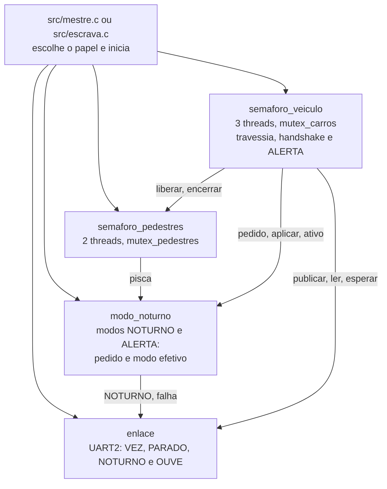
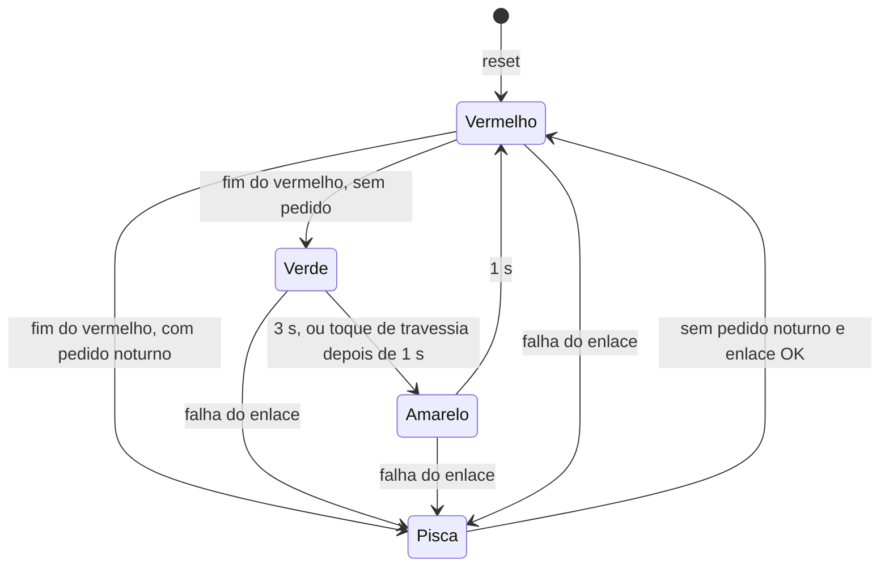
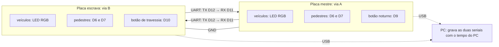
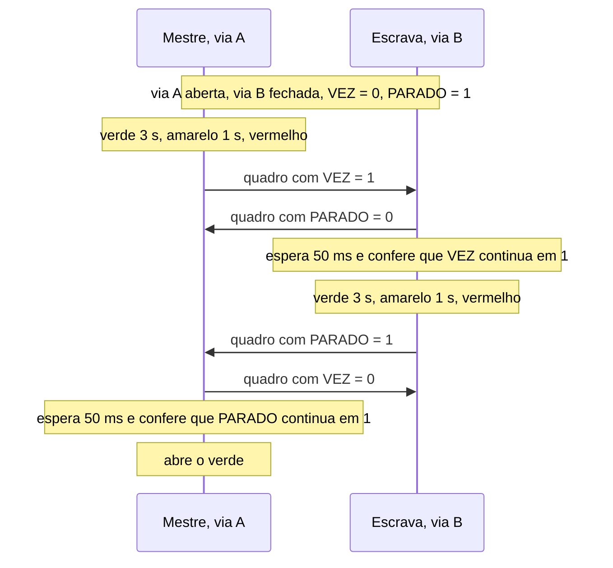

# Arquitetura

Este documento descreve como o sistema atende aos [requisitos](01-requisitos.md): primeiro dentro de cada placa (seção 1), depois entre as duas placas (seção 2). Os detalhes de cada módulo, os pinos e a montagem estão no [03-projeto-componentes.md](03-projeto-componentes.md).

**Leitura do enunciado:** o [enunciado](enunciado.md) pede o semáforo de pedestres numa placa e o de veículos na outra, numa única via. A dupla optou por um cruzamento de **duas vias**, com uma via completa (veículos e pedestres) em cada placa, como está no RF-01. Assim cada integrante usa o próprio microcontrolador, como o enunciado pede, e a comunicação entre as placas passa a ter uma regra de segurança clara: as duas vias nunca abrem juntas. Os semáforos de pedestres e de veículos continuam sincronizados, agora dentro de cada placa (seção 1.3).

## 1. Arquitetura do firmware

As duas placas rodam as mesmas quatro bibliotecas, em `lib/`. O que muda entre elas é o arquivo principal: `src/mestre.c` ou `src/escrava.c`. Ele só escolhe o papel da placa e inicia as bibliotecas na ordem certa.

### 1.1 Módulos

| Módulo | Responsabilidade | Interface pública |
|---|---|---|
| `lib/enlace` | Comunicação com a outra placa pela UART2. Manda o estado desta placa num quadro de 4 bytes, logo que ele muda e a cada 50 ms, e guarda o estado da outra placa a partir dos quadros válidos. O mestre manda VEZ e NOTURNO; a escrava manda PARADO; as duas mandam OUVE ("recebo você"). Sem quadro válido por 200 ms, os sinais da outra placa valem 0. Decide se o enlace está em **falha**, nos dois sentidos (seção 2.5). Na placa única, a UART não é usada. | `enlace_iniciar`, `enlace_sou_mestre`, `enlace_uma_placa`, `enlace_publicar`, `enlace_ler`, `enlace_esperar`, `enlace_aguardar_mudanca`, `enlace_publicar_noturno`, `enlace_ler_noturno`, `enlace_falhou` |
| `lib/modo_noturno` | Guarda os modos que fazem as luzes piscarem: NOTURNO e ALERTA. Para cada um, separa o **pedido** do **modo efetivo**. O pedido do noturno vem do botão (no mestre) ou do bit NOTURNO (na escrava); o do ALERTA é a falha do enlace. O modo efetivo só muda quando o semáforo de veículos o aplica. Tem a thread do botão, com debounce. | `modo_noturno_iniciar`, `modo_noturno_pedido`, `modo_noturno_aplicar`, `modo_noturno_ativo`, `modo_alerta_pedido`, `modo_alerta_aplicar`, `modo_alerta_ativo`, `modo_pisca` |
| `lib/semaforo_pedestres` | Threads do vermelho e do verde dos pedestres. Não decide nada sozinho: abre quando os veículos liberam, fecha quando os veículos pedem, e pisca o vermelho enquanto um modo de pisca estiver em vigor. | `semaforo_pedestres_iniciar`, `semaforo_pedestres_liberar`, `semaforo_pedestres_encerrar` |
| `lib/semaforo_veiculo` | Threads do verde, do amarelo e do vermelho dos veículos. É o centro da placa: comanda os pedestres, atende o botão de travessia, decide o ponto seguro do modo noturno, faz o handshake com a outra placa e entra e sai do ALERTA. | `semaforo_veiculo_iniciar` |
| `src/mestre.c`, `src/escrava.c` | Escolhem o papel e iniciam as bibliotecas. | — |

**Ordem de inicialização:** `enlace` → `modo_noturno` → `semaforo_pedestres` → `semaforo_veiculo`. Todas as threads são criadas com `K_THREAD_DEFINE` e começam bloqueadas num `k_sem`, então nenhuma luz acende antes da inicialização. O `semaforo_pedestres_iniciar` acende o vermelho dos pedestres. O `semaforo_veiculo` vem por último porque é ele que começa o ciclo, pelo vermelho dos veículos.

### 1.2 Threads

Uma thread por luz (RNF-01): três para os veículos e duas para os pedestres. O amarelo conta como uma luz só: ele usa os dois pinos do LED RGB, mas é comandado só pela `t_carro_amarelo`.

| Thread | Módulo | Prioridade | Controla | Espera por |
|---|---|---|---|---|
| `t_carro_verde` | `semaforo_veiculo` | 5 | Verde dos veículos (PTB19) | `vez_verde`; depois, o fim dos 3 s, o toque de travessia ou a falha do enlace |
| `t_carro_amarelo` | `semaforo_veiculo` | 5 | Amarelo dos veículos (PTB18 + PTB19), fixo ou piscando | `vez_amarelo` |
| `t_carro_vermelho` | `semaforo_veiculo` | 5 | Vermelho dos veículos (PTB18) | `vez_vermelho`; depois, os 4 s (placa única) ou a outra placa; por fim, `encerrado` |
| `t_ped_vermelho` | `semaforo_pedestres` | 5 | Vermelho dos pedestres (D6), fixo ou piscando | `vez_ped_vermelho`; depois, `liberado` |
| `t_ped_verde` | `semaforo_pedestres` | 5 | Verde dos pedestres (D7) | `vez_ped_verde`; depois, `encerrar` |
| `thread_botao` | `modo_noturno` | 4 | — | Toque no botão do modo noturno. Na escrava fica bloqueada para sempre, porque a interrupção do botão não é instalada. |
| `t_registro_travessia` | `semaforo_veiculo` | 5 | — | Toque no botão de travessia. Só registra o toque na serial; quem age no ciclo é a `t_carro_verde`. No mestre, que não tem o botão, fica bloqueada para sempre. |
| `t_enlace_rx` | `enlace` | 5 | — | Bytes recebidos pela UART2. Monta os quadros, descarta os inválidos, calcula a falha do enlace e avisa quem espera a outra placa. Não roda na placa única. |
| `t_enlace_tx` | `enlace` | 5 | — | Mudança no estado desta placa, ou 50 ms. Manda o quadro pela UART2. Não roda na placa única. |

- **Prioridade do botão noturno:** a `thread_botao` fica acima das threads das luzes para registrar o toque logo, mesmo com as luzes trocando.
- **Mesma prioridade para as outras:** a `t_registro_travessia`, a `t_enlace_rx` e a `t_enlace_tx` ficam na mesma prioridade das luzes. Assim nenhuma interrompe a outra no meio de uma linha da serial, e as linhas não se misturam. O custo é um registro poder atrasar alguns milissegundos.

### 1.3 Sincronização dentro da placa

| Mecanismo | Para quê | Requisito |
|---|---|---|
| Um `k_mutex` por semáforo (`mutex_carros`, `mutex_pedestres`) | Cada thread trava o mutex do seu semáforo antes de acender a luz e só destrava depois de apagá-la. Assim, duas luzes do mesmo semáforo nunca ficam acesas juntas. | RNF-02 |
| Cadeia de `k_sem` | Dá a ordem entre as luzes. Cada thread, ao terminar, dá o `k_sem_give` da próxima. | RF-01 |
| Interrupções curtas, sem mutex e sem espera | O Zephyr não permite travar mutex numa interrupção. As interrupções dos dois botões só dão `k_sem_give`; a do botão de travessia acorda a `t_carro_verde` e a `t_registro_travessia`. A interrupção da UART2 só copia cada byte recebido para uma fila (`k_msgq_put` sem espera). Quem decide é sempre uma thread. | — |

Um terceiro mutex, `mutex_modo`, protege os pedidos e os modos efetivos (NOTURNO e ALERTA), que são lidos pelas threads das luzes e escritos pela thread do botão e pelo semáforo de veículos.

**Um ciclo, na ordem dos sinais:**

**Por que os pedestres nunca atravessam com os carros abertos, por construção e não por tempo:**
- O verde dos pedestres só acende depois de `liberado`, e `liberado` só é dado com o vermelho dos veículos já aceso.
- O vermelho dos veículos só apaga depois de `encerrado`, e `encerrado` só é dado com o vermelho dos pedestres já aceso.

Entre um passo e outro há um instante com os dois semáforos no vermelho. No TI-01, esse instante durou no máximo 2,7 ms.

### 1.4 Modos de operação

O estado da placa é o estado do semáforo de veículos. Os pedestres acompanham pela cadeia da seção 1.3.

**Modo normal:** o ciclo da seção 1.3. Com uma placa só, 3 s de verde, 1 s de amarelo e 4 s de vermelho. Com duas, o vermelho dura a vez da outra placa (seção 2.3).

**Travessia (RF-03):** não é um modo à parte, só encurta o verde dos veículos. O botão fica só na escrava; o mestre não configura o D10, e o verde dele sempre dura 3 s.
- A interrupção do botão dá `k_sem_give(&pedido_travessia)`. A `t_carro_verde` aceita esse sinal depois de 1 s de verde (o verde mínimo) e, se ele chegar, encerra o verde. Os carros passam pelo amarelo e fecham, e os pedestres abrem.
- No começo de cada verde, a `t_carro_verde` zera o `pedido_travessia`. Por isso um toque com os carros no vermelho, no amarelo ou piscando não tem efeito, nem agora nem depois.
- O controle não tem debounce. Vários toques, ou o repique do fio, só dão vários `k_sem_give` num semáforo que conta até 1, e o efeito é o de um toque só. Com toques sem parar, cada verde dura o mínimo de 1 s, e o ciclo continua.
- A `t_registro_travessia` escreve `botao travessia: toque` na serial a cada toque, em qualquer fase e modo. Ela filtra o repique só para o registro.

**Modo noturno (RF-02):**
- **Pedido e modo efetivo:** o botão (ou o bit NOTURNO, na escrava) muda só o pedido. A `t_carro_vermelho` lê o pedido no **ponto seguro**, no fim do vermelho, e só então liga o modo efetivo. Assim nenhuma fase do ciclo é interrompida.
- **Entrada:** com o pedido ligado, a `t_carro_vermelho` encerra os pedestres, liga o modo efetivo e dá `vez_amarelo` no lugar de `vez_verde`. Como o pedido só é lido no fim do vermelho, a entrada pode levar até cerca de 8 s depois do toque (seção 5).
- **Pisca:** a `t_carro_amarelo` alterna o amarelo a cada 1 s. A `t_ped_vermelho`, que espera `liberado` com prazo de 1 s, alterna o vermelho dos pedestres a cada prazo vencido. Cada troca vai para a serial.
- **Saída:** a `t_carro_amarelo` confere o pedido a cada 1 s. Quando ele desliga, ela desliga o modo efetivo e dá `vez_vermelho`. A placa volta ao ciclo normal pelo vermelho.

**Modo ALERTA (RF-04 a RF-06):** acende as mesmas luzes do noturno, mas o motivo é a falha do enlace com a outra placa (seção 2.5), e ele tem prioridade sobre o noturno.
- **Entrada, em qualquer fase:** o ALERTA não espera o ponto seguro. No verde, a `t_carro_verde` confere a falha a cada 50 ms e encerra o verde na hora. No amarelo, o amarelo de 1 s termina e continua piscando. No vermelho, as esperas do handshake são canceladas, os pedestres fecham, e o amarelo começa a piscar.
- **Pisca:** o mesmo do noturno. Os pedestres começam a piscar em até 1 s, pelo prazo da `t_ped_vermelho`.
- **Saída:** a `t_carro_amarelo` confere o enlace a cada 1 s. Quando ele volta, ela desliga o ALERTA e dá `vez_vermelho`. A placa recomeça o revezamento como no boot (seção 2.5).

### 1.5 Papel da placa

| Papel | Arquivo | Enlace | Botão noturno | Botão de travessia | Vermelho dos veículos |
|---|---|---|---|---|---|
| Mestre | `src/mestre.c` | `ENLACE_MESTRE`: manda VEZ e NOTURNO, recebe PARADO | Sim (D9) | Não | Dura a vez da escrava |
| Escrava | `src/escrava.c` | `ENLACE_ESCRAVA`: manda PARADO, recebe VEZ e NOTURNO | Não | Sim (D10) | Dura até o mestre dar a vez |
| Placa única | `src/mestre.c` com `UMA_PLACA=1` | `ENLACE_UNICA`: a UART2 não é usada, e o enlace nunca falha | Sim (D9) | Sim (D10) | 4 s fixos |

O papel é escolhido na compilação, pela variável `PAPEL` do `CMakeLists.txt`, com uma pasta de build por papel (seção 2 do [03-projeto-componentes.md](03-projeto-componentes.md)). As bibliotecas são as mesmas nos três casos. A placa única roda o firmware principal numa placa só, sem o handshake e sem o ALERTA.

## 2. Arquitetura do sistema

### 2.1 Visão geral

Cada placa controla uma via completa. As duas vias trabalham em fases opostas, e o mestre decide de quem é a vez. As placas conversam por uma UART, a UART2 da KL25Z.

O PC não participa do controle. Ele só grava as duas seriais (a UART0 de cada placa, pelo USB) com o [`captura_serial.py`](../tests/ferramentas/captura_serial.py), que põe o tempo do PC em cada linha. Os relógios das placas partem de instantes diferentes, então é o tempo do PC que mostra a ordem dos eventos entre as placas.

### 2.2 Mensagens entre as placas

| Fio | De | Para | Função |
|---|---|---|---|
| 1 | GND | GND | Referência comum. Obrigatório. |
| 2 | D12 (PTD3, UART2 TX) do mestre | D11 (PTD2, UART2 RX) da escrava | Quadros do mestre |
| 3 | D12 (PTD3, UART2 TX) da escrava | D11 (PTD2, UART2 RX) do mestre | Quadros da escrava |

Cada placa manda à outra um **quadro de 4 bytes** com o próprio estado, a 115200 bps:

| Byte | Conteúdo |
|---|---|
| 0 | `0xA5`, início do quadro |
| 1 | Bits: SINAL (VEZ, no mestre; PARADO, na escrava), NOTURNO (só o mestre), MESTRE (papel de quem mandou) e OUVE (quem mandou está recebendo quadros válidos da outra) |
| 2 | Contador, que aumenta a cada quadro |
| 3 | Verificação: o complemento da soma dos três primeiros bytes |

- **Estado, não evento:** o quadro carrega o estado inteiro, e não "aconteceu tal coisa". Ele é mandado logo que o estado muda e repetido a cada 50 ms. Um quadro perdido é corrigido pelo seguinte.
- **Quadro válido:** começa com `0xA5`, só usa os bits conhecidos, tem a verificação certa e vem de uma placa com o **papel oposto**. Os outros são descartados. Assim, o mesmo programa nas duas placas, ou um TX ligado no próprio RX, nunca é confundido com a outra placa.
- **Estado seguro:** sem quadro válido por **200 ms**, a placa registra `enlace perdido`, e os sinais da outra placa passam a valer 0: sem vez, escrava não parada, modo normal, e OUVE = 0. O 0 nunca libera nenhuma via.
- **Proteção:** um resistor de 1 kΩ em série em cada fio de dados limita a corrente se dois TX forem ligados juntos por engano, e também a corrente que vai para uma placa desligada.

### 2.3 Protocolo de revezamento (RF-01)

O revezamento é um handshake com dois sinais lógicos, que viajam nos quadros. O mestre dá a vez com VEZ, e a escrava confirma com PARADO que está no vermelho fixo. **Nenhuma placa abre sem a confirmação da outra.**

| Mestre | Escrava |
|---|---|
| 1. Só abre com VEZ = 0 e PARADO = 1. | 1. Só abre numa subida de VEZ. No boot e depois de um ALERTA, só depois de ter visto VEZ = 0 por 1 s. |
| 2. Só levanta VEZ com os próprios veículos no vermelho e a escrava parada (PARADO = 1). | 2. Baixa PARADO antes de abrir, e também ao entrar no ALERTA. |
| 3. Baixa VEZ quando PARADO volta a 1. | 3. Só levanta PARADO depois de voltar ao vermelho. |

| Tempo | Veículos A | Pedestres A | Veículos B | Pedestres B | VEZ | PARADO |
|---|---|---|---|---|---|---|
| 0 a 3 s | verde | vermelho | vermelho | verde | 0 | 1 |
| 3 a 4 s | amarelo | vermelho | vermelho | verde | 0 | 1 |
| 4 a 7 s | vermelho | verde | verde | vermelho | 1 | 0 |
| 7 a 8 s | vermelho | verde | amarelo | vermelho | 1 | 0 |

**Casos de borda tratados:**

| Caso | Tratamento |
|---|---|
| O mestre cancela a vez no mesmo instante em que a escrava decide abrir | A escrava baixa PARADO, espera 50 ms (`GUARDA_MS`) e confere de novo que VEZ continua em 1. Se não continuar, volta a PARADO = 1 e não abre. |
| A escrava não pega a vez, com o enlace OK (por exemplo, acabou de reiniciar e ainda não viu VEZ = 0 por 1 s) | Depois de 3 s (`RESPOSTA_MS`), o mestre cancela a vez, espera 5 s (`ESPERA_CANCELADA_MS`, o ciclo inteiro da escrava mais 1 s) e segue o próprio ciclo. A espera garante que, se a escrava abriu sem o mestre ver, ela já fechou. |
| Boot | O mestre abre primeiro, assim que recebe PARADO = 1. A escrava espera ver VEZ = 0 estável por 1 s e pega a vez no fim do primeiro ciclo do mestre. |

**Efeito nos tempos:** o vermelho de cada via dura a vez da outra mais o handshake: duas guardas de 50 ms, uma de cada placa, mais as mensagens na serial. Um quadro leva 0,35 ms para ser transmitido. Por isso, com duas placas, o vermelho dos veículos e o verde dos pedestres duram cerca de 4,1 s.

**A travessia com duas placas (RF-03):** o botão encurta o verde da escrava. Ela passa pelo amarelo, fecha e levanta PARADO, e o mestre abre em seguida, pelo mesmo handshake. Nada muda no protocolo.

### 2.4 Modo noturno com duas placas (RF-02)

- **Só o mestre tem o botão.** As duas placas usam o mesmo modelo de pedido e modo efetivo, e só muda a origem do pedido: na escrava, ele é o bit NOTURNO do quadro do mestre.
- **Entrada:** o mestre lê o pedido no próprio ponto seguro, que é depois de a escrava fechar, com VEZ = 0. Então ele liga o modo efetivo e manda NOTURNO = 1. A escrava, que está no vermelho esperando a vez, confere o pedido a cada 50 ms e entra no pisca logo em seguida. As duas entram no pisca com as duas vias fechadas.
- **Durante o pisca:** o mestre mantém VEZ = 0. O próximo VEZ = 1 é uma vez nova para a escrava.
- **Saída:** o mestre sai do pisca até 1 s depois do pedido, manda NOTURNO = 0, vai para o vermelho e dá a vez. Por isso a escrava abre primeiro. A escrava confere o pedido a cada 1 s, dentro do pisca, então sai até 2 s depois do pedido.
- **O pisca das duas vias não é sincronizado** entre as placas, porque os requisitos não pedem isso.

### 2.5 Modo ALERTA e falhas (RF-04 a RF-06)

A regra geral: **na dúvida, as duas placas piscam no ALERTA, e nenhuma abre.**

**Detecção da falha.** O bit OUVE faz a falha valer nas duas pontas, qualquer que seja o fio:
- Uma placa está em **falha** se não recebe quadros válidos da outra há mais de 200 ms, **ou** se a outra avisa, com OUVE = 0, que não recebe os quadros desta.
- Com um fio de dados solto, a placa do lado do RX solto para de receber e entra em falha em cerca de 0,2 s. Ela passa a mandar OUVE = 0, e a outra, que ainda recebe, entra em falha no quadro seguinte (até 50 ms depois).
- Nos primeiros 0,5 s depois do boot, a falha não é declarada, para dar tempo de as placas trocarem os primeiros quadros.
- A serial registra `enlace FALHA` e `enlace OK`, e o modo, `modo ALERTA` e `modo NORMAL` (ou `modo NOTURNO`).

**Entrada.** A placa em falha entra no ALERTA na fase em que estiver (seção 1.4) e publica o sinal seguro: o mestre, VEZ = 0; a escrava, PARADO = 0, porque piscando ela não está no vermelho fixo.

**Saída e recomeço.** Quando o enlace volta, cada placa sai do pisca em até 1 s e vai para o vermelho. O revezamento recomeça como no boot:
- o mestre abre primeiro, mas só depois de ver PARADO = 1, ou seja, com a escrava no vermelho fixo. Enquanto ela ainda pisca, PARADO = 0, e o mestre espera;
- a escrava só aceita a vez depois de ver VEZ = 0 por 1 s, o que acontece durante o verde do mestre.

Recomeçar pelo mestre evita que o mestre dê a vez a uma escrava que acabou de reiniciar e ainda não pode aceitá-la, o que deixaria as duas vias uns 8 s no vermelho.

| Falha | O que acontece | Requisito | Teste |
|---|---|---|---|
| Uma placa desligada | A outra deixa de receber quadros e entra no ALERTA em cerca de 0,2 s. Ao religar a placa, as duas voltam ao normal. | RF-04 | TA-02 |
| TX do mestre solto | A escrava deixa de receber e entra no ALERTA; o mestre recebe OUVE = 0 e entra também. | RF-05 | TA-03 |
| RX do mestre solto (TX da escrava) | O mestre deixa de receber e entra no ALERTA; a escrava recebe OUVE = 0 e entra também. | RF-05 | TA-03 |
| Os dois fios soltos | As duas deixam de receber e entram no ALERTA. | RF-05 | TA-03 |
| Uma placa reinicia | Enquanto ela reinicia, a outra entra no ALERTA (como uma placa desligada). A placa reiniciada volta no vermelho. As duas retomam o ciclo pelo recomeço acima. Se o reinício durar menos de 0,2 s, a outra nem entra no ALERTA, e as regras do handshake bastam: a placa reiniciada volta fechada e, se for a escrava, espera VEZ = 0 estável. | RF-06 | TA-04 |
| Ruído no fio de dados | Quadros com a verificação errada são descartados. Se nenhum válido chegar em 200 ms, vale a falha. | — | — |
| Mesmo programa nas duas placas, ou TX ligado no próprio RX | Os quadros com o próprio papel são descartados, com o aviso `enlace: quadro com o mesmo papel desta placa`. O enlace nunca fica OK, e a placa fica no ALERTA. | — | — |

- **Por que as duas vias nunca abrem juntas, mesmo com falha:** no ALERTA, as duas placas só piscam o amarelo. Ao sair dele, o mestre só abre com a escrava no vermelho fixo (PARADO = 1), e a escrava só abre com a vez do mestre (VEZ = 1), que ele só dá com os próprios veículos no vermelho.
- **Fio GND solto:** sem a referência comum, a UART não funciona, e o caso vira o de enlace em falha. Como as duas placas costumam estar no mesmo PC pelo USB, o GND pode continuar comum pelo cabo, e a falha pode nem aparecer. O GND é condição de montagem e deve ser o primeiro fio a ser ligado.

## 3. Rastreabilidade

| Requisito | Onde a arquitetura atende | Testes |
|---|---|---|
| RF-01: duas vias, sem travar e sem as duas abertas | Cadeia de `k_sem` e contrato `liberar`/`encerrar` (1.3); handshake (2.3) | TI-01, TI-02, TA-01 |
| RF-02: botão do modo noturno nas duas placas | Modo noturno (1.4); bit NOTURNO (2.4) | TS-01, TA-01 |
| RF-03: botão de travessia | `t_carro_verde` e interrupção do D10 (1.4); com duas placas (2.3) | TS-02, TA-01 |
| RF-04: placa desconectada → ALERTA | Falha do enlace e modo ALERTA (1.4, 2.5) | TA-02 |
| RF-05: fio solto → ALERTA nas duas | Bit OUVE (2.2, 2.5) | TU-03, TA-03 |
| RF-06: reinício sem travar e sem as duas abertas | Recomeço depois do ALERTA e regras do boot (2.3, 2.5) | TA-04 |
| RNF-01: uma thread por luz | Threads (1.2) | Revisão de código |
| RNF-02: mutex por semáforo | `mutex_carros` e `mutex_pedestres` (1.3) | Revisão de código |

## 4. Pontos de integração (modelo V)

Cada interface da arquitetura vira um ponto de teste:

| Interface | O que testar | Teste |
|---|---|---|
| Semáforo de pedestres sozinho | Tempos e uma luz por vez | TU-01 |
| Semáforo de veículos sozinho | Tempos e ordem das luzes | TU-02 |
| Placa e placa (quadros da UART) | Quadros chegam nos dois sentidos, sem perda | TU-03 |
| Veículos e pedestres da mesma placa (`liberar`, `encerrar`) | Ordem das trocas e nenhuma sobreposição | TI-01 |
| Placa e placa (VEZ e PARADO) | Revezamento, nunca as duas vias abertas | TI-02 |
| Veículos e modo noturno (botão, `pedido`, `aplicar`) | Entrada no ponto seguro, pisca de 1 s, saída | TS-01 |
| Veículos e botão de travessia | Encurta só o verde, respeitando 1 s | TS-02 |
| Sistema completo (NOTURNO e travessia com duas placas) | As duas placas no modo noturno; a outra via abre depois da travessia | TA-01 |
| Falhas do enlace | Cada caso da seção 2.5 | TA-02, TA-03, TA-04 |

## 5. Limitações conhecidas

1. **Entrada no modo noturno:** como ela só acontece no ponto seguro, o pisca pode começar até cerca de 8 s depois do toque, com uma placa ou com duas. Um segundo toque antes disso cancela o pedido, e o modo noturno não chega a entrar. Os procedimentos do TS-01 (esperar cerca de 4 s) e do TA-01 (cerca de 3 s) devem esperar o pisca começar antes do segundo toque.
2. **Pisca sem sincronia:** o pisca das duas placas não é sincronizado entre elas. No ALERTA que começa no verde, o pisca dos pedestres também pode ficar fora de fase com o dos veículos da mesma placa, porque começa no próximo prazo de 1 s da `t_ped_vermelho`.
3. **UART2 descrita à mão:** o Zephyr não descreve a UART2 da KL25Z, e o nó dela foi escrito no `frdm_kl25z.overlay` a partir do manual do chip. A comunicação foi validada nas placas pelo TU-03.
