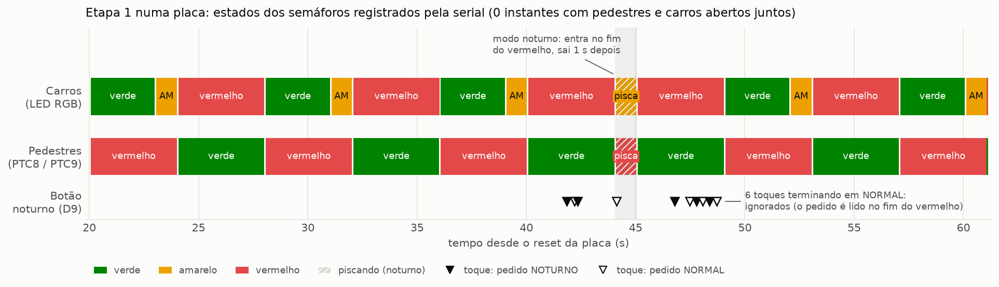

# PSI-Microcontroladores2-Aula07
Atividade: Semáforos de Pedestres e Veículos

## Objetivo
Desenvolver um sistema embarcado de controle de semáforos para pedestres e veículos, utilizando **threads** e **mutex**, e validar o funcionamento do código por meio de **testes utilizando o modelo V (testes unitários, de integração e de sistema)**.  
Opcionalmente, alunos podem utilizar **IA generativa** para auxiliar na elaboração de trechos de código ou na geração de planos de teste, mas **a avaliação deve se concentrar na qualidade dos testes e na correta validação do sistema**.

## Trabalho em Dupla
- A atividade deve ser realizada **em duplas**.
- Cada membro deve contribuir ativamente no desenvolvimento.
- **Commits no repositório Git** devem ser feitos de forma individual, permitindo a avaliação das contribuições de cada aluno.

## Descrição do Sistema
O sistema deve controlar semáforos de dois tipos: pedestres e carros, incluindo **modo noturno** e **botão de travessia de pedestres**.

### 1. Semáforo de Pedestres
- Contém dois LEDs: verde e vermelho.
- Comportamento:
  - Verde acende por 4 segundos.
  - Vermelho acende por 4 segundos.
- Controle deve ser feito por **duas threads independentes**, garantindo exclusão mútua (**mutex**) entre verde e vermelho.
- Deve ser utilizado o microcontrolador de um integrante.

### 2. Semáforo de Veículos
- Contém três LEDs: verde, amarelo e vermelho.
- Comportamento:
  - Verde acende por 3 segundos.
  - Amarelo acende por 1 segundo.
  - Vermelho acende por 4 segundos.
- Controle deve ser feito por **três threads independentes**, garantindo exclusão mútua (**mutex**) entre os LEDs.
- Deve ser validado que há **sincronismo** entre o semáforo de pedestres e o semáforo de veículos.
- Deve ser utilizado o microcontrolador do outro integrante.

### 3. Modo Noturno
- Um modo alternativo em que os semáforos piscam:
  - Carros: amarelo piscando a cada 2 segundos (1 segundo aceso, 1 segundo apagado).
  - Pedestres: vermelho piscando a cada 2 segundos (1 segundo aceso, 1 segundo apagado).

### 4. Botão de Travessia
- Permite que pedestres acionem o semáforo:
  - Pedestre verde é ativado.
  - Semáforo de carros é bloqueado de forma segura.
- O sistema deve suportar uma única via
- Controle de acesso deve garantir **consistência entre semáforos**, evitando conflito de LEDs.

## Requisitos de Projeto
1. Cada LED deve ser controlado por **uma thread**.
2. Threads devem utilizar **mutex** para evitar conflitos.
3. Modos de operação:
   - Normal (dia)
   - Noturno
   - Travessia acionada pelo botão
4. **Validação do código**
   - Alunos devem elaborar **planos de testes completos**, seguindo o **modelo V**, para garantir o correto funcionamento de cada parte e do sistema completo.
   - Testes devem incluir:
     - Testes unitários (cada semáforo)
     - Testes de integração (interação entre semáforos)
     - Testes de sistema (modos noturno e botão de travessia)
6. **Uso de IA generativa**
   - Sugestão de uso para auxiliar na geração de código ou testes.
   - A avaliação será baseada **na qualidade dos testes e nas evidências registradas no repositório**, não apenas na implementação do código.
7. **Controle de contribuições individuais**
   - Cada membro da dupla deve realizar **commits separados** no repositório.
   - A avaliação individual considerará o histórico de commits e a participação de cada aluno no desenvolvimento e validação do sistema.

---

# Relatório de testes: etapa 1 do semáforo (uma placa)

> **Registro histórico.** Este relatório é da primeira versão do projeto, com uma placa só e anterior aos requisitos atuais. Os testes atuais estão no [plano de testes](../tests/plano-testes.md). O `src/README.md` citado abaixo foi removido; a versão usada aqui está no commit [`04549c0`](https://github.com/bmchad/uc-aula1-fork/blob/04549c0/src/README.md).

| | |
|---|---|
| **Aluno** | Bernardo Machado |
| **Data dos testes** | 18/11/2026 |
| **Firmware testado** | Commit [`8ae444e`](https://github.com/bmchad/uc-aula1-fork/commit/8ae444e), com `UMA_PLACA true` em [`src/main.c`](https://github.com/bmchad/uc-aula1-fork/blob/8ae444e/src/main.c) (hoje [`src/mestre.c`](../src/mestre.c)) |
| **Projeto** | [`src/README.md`](https://github.com/bmchad/uc-aula1-fork/blob/04549c0/src/README.md) (removido depois): arquitetura das duas placas, e plano de testes. As conexões estão hoje no [03-projeto-componentes.md](03-projeto-componentes.md), e a montagem da etapa 1 é a da seção 1.5 |
| **Evidências** | [`docs/semaforo/`](https://github.com/bmchad/uc-aula1-fork/tree/5890a32/docs/semaforo) (no commit `5890a32`; a pasta saiu do repositório depois): logs da serial, linha do tempo e o script de análise ([anexos](#anexos)) |
| **Situação** | T0 a T4 aprovados; T5 inconclusivo; T6, T7 e T8 pendentes ([seção 6](#6-pendências)) |

## 1. Objetivo

Validar numa placa só, antes de ligar a segunda, as cinco threads (três dos carros e duas dos pedestres), os dois mutexes e o sincronismo entre os semáforos de carros e de pedestres. Na etapa 1 não há handshake entre placas, e o vermelho dos carros dura 4 s fixos.

## 2. Ambiente de teste

- **Placa:** FRDM-KL25Z com Zephyr 4.2, compilado pelo PlatformIO. O build sai sem avisos, com Flash em 12,7% e RAM em 56,8%.
- **Carros:** LED RGB da placa. Vermelho no PTB18, verde no PTB19 e amarelo com os dois acesos.
- **Pedestres:** LEDs avulsos com resistor de 220 Ω até o GND. Vermelho no PTC8 (D6) e verde no PTC9 (D7).
- **Botão do modo noturno:** um fio no D9, que é encostado no GND.
- **Registro:** cada troca de luz sai pela serial (115200 bps) como `tempo ms | evento`. O tempo é contado pela placa desde o reset. Um script Python no PC grava cada linha com o tempo do PC na frente, separado por TAB. As durações abaixo usam o tempo da placa.

**Limite das evidências:** a serial registra o que o firmware comanda, e não o que o LED mostra. Durante as capturas, os LEDs avulsos estavam com mau contato na protoboard e não acenderam ([seção 5](#5-problemas-encontrados)). Por isso a verificação visual dos LEDs ficou pendente (T8).

## 3. Plano de testes (modelo V)

| Teste | Nível | O que verifica | Critério de aprovação |
|---|---|---|---|
| T0 | — | Build e gravação | Sem erros |
| T1 | Unitário | Boot no modo de placa única | Mensagem `PLACA UNICA (etapa 1)`; carros e pedestres começam no vermelho |
| T2 | Unitário | Tempo de cada luz | Carros 3 s, 1 s e 4 s; pedestres 4 s e 4 s; erro abaixo de 1% |
| T3 | Integração, dentro da placa | Sincronismo e exclusão mútua entre carros e pedestres | Nenhum instante com os pedestres no verde e os carros no verde ou no amarelo |
| T4 | Sistema | Entrada e saída do modo noturno | Só entra no fim do vermelho dos carros; sai em até 1 s |
| T5 | Sistema | Debounce do botão noturno | Cada toque gera uma alternância |
| T6 | Sistema | Pisca do modo noturno | 1 s aceso e 1 s apagado, com carros e pedestres juntos |
| T7 | Sistema | Botão de travessia (D10) | Encurta o verde dos carros, respeitando o mínimo de 1 s |
| T8 | Sistema | Verificação visual dos LEDs | Os LEDs seguem os estados registrados na serial |

## 4. Resultados

### 4.1 T0 e T1: gravação e boot

A gravação terminou sem erros. Log do boot ([`captura_boot.log`](https://github.com/bmchad/uc-aula1-fork/blob/5890a32/docs/semaforo/captura_boot.log)):

```
*** Booting Zephyr OS build zephyr-v40200 ***
Semaforo iniciado como PLACA UNICA (etapa 1)
8 ms | carros VERMELHO
10 ms | pedestres VERMELHO
12 ms | pedestres VERDE
```

As duas ruas começam fechadas, e o verde dos pedestres só acende depois do vermelho dos carros. **Aprovado.**

### 4.2 T2: tempos

Captura de 45 s com a placa rodando ([`captura_ciclos.log`](https://github.com/bmchad/uc-aula1-fork/blob/5890a32/docs/semaforo/captura_ciclos.log)). Só entram as fases completas, e a fase do modo noturno fica de fora.

| Fase | Medido | Enunciado | Fases medidas |
|---|---|---|---|
| Carros: verde | 3,002 s | 3 s | 4 |
| Carros: amarelo | 1,002 a 1,003 s | 1 s | 5 |
| Carros: vermelho | 4,005 a 4,008 s | 4 s | 5 |
| Pedestres: verde | 4,000 a 4,001 s | 4 s | 5 |
| Pedestres: vermelho | 4,009 a 4,010 s | 4 s | 4 |
| Ciclo completo (verde a verde) | 8,010 s | 8 s | 3 |

Os 10 ms a mais por ciclo (0,125%) vêm das trocas entre threads e das mensagens na serial. **Aprovado.**

### 4.3 T3: sincronismo e exclusão mútua



- Em 5 ciclos, não houve nenhum instante com os pedestres no verde e os carros no verde ou no amarelo.
- Nas 11 trocas entre os dois semáforos, a segunda luz acendeu 2 a 3 ms depois da primeira. O verde dos pedestres sempre veio depois do vermelho dos carros, e o verde dos carros sempre depois do vermelho dos pedestres.
- Essa ordem é garantida pela cadeia de `k_sem`, e não por tempo. O vermelho dos carros só libera os pedestres depois de acender. Ele só apaga depois que `semaforo_pedestres_encerrar()` retorna, e ela só retorna com o vermelho dos pedestres aceso.

**Aprovado.**

### 4.4 T4: modo noturno

| Tempo da placa | Evento | Leitura |
|---|---|---|
| 41,857 a 42,335 s | 3 toques: NOTURNO, NORMAL, NOTURNO | O pedido final é NOTURNO, feito com os carros no vermelho |
| 44,059 s | Fim do vermelho dos carros; `modo NOTURNO` | Entrou no ponto seguro, e não no meio de uma fase |
| 44,136 s | Toque: NORMAL | — |
| 45,067 s | `modo NORMAL`; carros no vermelho e pedestres no verde | Saiu no fim do primeiro pisca, que durou 1,005 s |
| 46,795 a 48,705 s | 6 toques, terminando em NORMAL | Ignorados, porque o pedido só é lido no fim do vermelho |

**Aprovado** para a entrada e a saída. O pisca em si é o T6.

### 4.5 T5: debounce do botão noturno

O log tem 10 alternâncias em 7 s, algumas com só 133 ms entre elas. Não foi registrado quantas vezes o fio encostou no GND, então não dá para separar os toques reais do repique do fio. **Inconclusivo.** Se for repique, a correção é exigir que o pino fique solto por cerca de 300 ms antes de aceitar um novo toque. Hoje esse tempo é de 50 ms.

## 5. Problemas encontrados

| Problema | Causa | Solução |
|---|---|---|
| O build parava com o Error 4551 | O Device Guard (Smart App Control) do Windows bloqueia o `arm-none-eabi-g++.exe` | O `device_guard_fix.py` troca o g++ pelo gcc ([`50f603f`](https://github.com/bmchad/uc-aula1-fork/commit/50f603f)) |
| A porta serial sumiu durante a primeira captura | A placa foi removida do USB | Captura refeita. O boot já tinha sido registrado antes da remoção. |
| Os LEDs avulsos não acendiam | Mau contato na protoboard | Antes de mexer na montagem, foi conferido que o firmware configura o PTC8 e o PTC9: devicetree final, driver de GPIO e log de boot sem erro. Depois a montagem foi refeita. |

## 6. Pendências

- **T5:** repetir o teste contando os toques.
- **T6:** o modo noturno ficou ativo só 1 s. É preciso refazer com ele ativo por pelo menos 6 s. O pisca não sai na serial, então a evidência precisa ser um vídeo, ou o firmware precisa imprimir cada troca.
- **T7:** botão de travessia pelo D10.
- **T8:** verificação visual com os LEDs funcionando, com um vídeo de um ciclo completo.
- **Etapa 2:** testes de integração entre as duas placas ([`src/README.md`](https://github.com/bmchad/uc-aula1-fork/blob/04549c0/src/README.md), seção 7).

## Anexos

| Arquivo | Conteúdo |
|---|---|
| [`captura_boot.log`](https://github.com/bmchad/uc-aula1-fork/blob/5890a32/docs/semaforo/captura_boot.log) | Boot logo depois da gravação |
| [`captura_ciclos.log`](https://github.com/bmchad/uc-aula1-fork/blob/5890a32/docs/semaforo/captura_ciclos.log) | 45 s de ciclos, com os toques do botão e o modo noturno |
| [`figura1_linha_do_tempo.png`](https://github.com/bmchad/uc-aula1-fork/blob/5890a32/docs/semaforo/figura1_linha_do_tempo.png) | Linha do tempo gerada a partir de `captura_ciclos.log` |
| [`analisa_etapa1.py`](https://github.com/bmchad/uc-aula1-fork/blob/5890a32/docs/semaforo/analisa_etapa1.py) | Calcula as durações e as violações e gera a figura: `python docs/semaforo/analisa_etapa1.py docs/semaforo/captura_ciclos.log saida.png` |

Formato dos logs: `tempo do PC (s)`, TAB, `tempo da placa (ms) | evento`.
