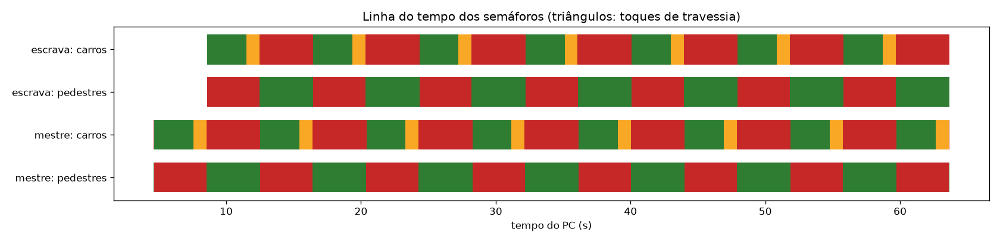

# TA-03: sincronismo e ordem das trocas

Teste descrito no [plano de testes](../../plano-testes.md#ta-03-sincronismo-e-ordem-das-trocas).

| | |
|---|---|
| **Requisitos** | RF-05, RS-03 |
| **Nível** | Integração. |
| **Data** | 21/11/2026 |
| **Executado por** | Felipe (análise dos logs do TA-02) |
| **Commit testado** | 42e811b, o mesmo do TA-02 |
| **Firmware** | Os mesmos do TA-02: parte A com `-DPAPEL=placa_unica`; parte B com `-DPAPEL=mestre` e `-DPAPEL=escrava`. |
| **Situação** | Aprovado |

## 1. Montagem e pré-condição

- Não houve captura nova: o teste usa os logs do TA-02 e as análises deles, feitas com a [analisa_log.py](../../ferramentas/analisa_log.py).

## 2. Capturas

| Arquivo | O que é |
|---|---|
| [../TA-02/parteA.log](../TA-02/parteA.log) | Log da parte A do TA-02 (uma placa, cerca de 50 s) |
| [../TA-02/parteA_analise.md](../TA-02/parteA_analise.md) | Análise da parte A, seção "Sincronismo e segurança dentro de cada via" |
| [../TA-02/parteB.log](../TA-02/parteB.log) | Log da parte B do TA-02 (duas placas, cerca de 60 s) |
| [../TA-02/parteB_analise.md](../TA-02/parteB_analise.md) | Análise da parte B, seções "Sincronismo e segurança dentro de cada via" e "Segurança entre as vias" |
| [linha_do_tempo.png](linha_do_tempo.png) | Linha do tempo das duas vias na parte B, gerada com `analisa_log.py --figura` |

## 3. Critérios

| Requisito | Critério | Medido | Resultado |
|---|---|---|---|
| RF-05 | Parte A: em cada troca, o outro semáforo da via muda em até 50 ms | 14 trocas, pior atraso de 4 ms | Aprovado |
| RF-05 | Parte B, nas duas vias: em cada troca, o outro semáforo da via muda em até 50 ms | Mestre: 17 trocas, pior de 5 ms. Escrava: 15 trocas, pior de 3 ms | Aprovado |
| RS-03 | Dentro de cada via: o verde dos pedestres só depois do vermelho dos veículos, e o verde dos veículos só depois do vermelho dos pedestres | Nenhuma troca fora de ordem, nas partes A e B | Aprovado |
| RS-03 | Entre as vias (parte B, pelo tempo do PC): o `carros VERMELHO` de uma via sempre antes do `carros VERDE` da outra; anotar a menor folga | 15 aberturas, todas depois do fechamento da outra via. Folgas de 52 a 57 ms; a menor, 52 ms, aconteceu duas vezes, ao abrir a escrava | Aprovado |

**Folga de cada troca de vez, pelo tempo do PC** (do `carros VERMELHO` de uma via ao `carros VERDE` da outra):

| Abre | Tempo da placa que abre | Folga |
|---|---|---|
| escrava | 4135 ms | 55 ms |
| mestre | 8183 ms | 54 ms |
| escrava | 12257 ms | 52 ms |
| mestre | 16304 ms | 57 ms |
| escrava | 20379 ms | 55 ms |
| mestre | 24426 ms | 55 ms |
| escrava | 28500 ms | 55 ms |
| mestre | 32548 ms | 54 ms |
| escrava | 36622 ms | 54 ms |
| mestre | 40670 ms | 53 ms |
| escrava | 44744 ms | 52 ms |
| mestre | 48791 ms | 56 ms |
| escrava | 52866 ms | 55 ms |
| mestre | 56913 ms | 55 ms |
| escrava | 60987 ms | 53 ms |

## 4. Observações

- **O tempo do PC é confiável para a ordem entre as vias.** Descontando a escala do relógio (item abaixo), o atraso do USB variou só de −5 a +6 ms ao longo da captura, bem menos que a menor folga, de 52 ms.
- **Confirmação que não depende do PC.** Em cada ciclo, a soma das duas folgas (o mestre fecha e a escrava abre; a escrava fecha e o mestre abre), medida só com os relógios das placas, deu de 112 a 113 ms nos 7 ciclos completos. Na soma, a diferença entre os dois relógios se cancela. O valor bate com as duas guardas de 50 ms do handshake mais as mensagens na serial, ou seja, cerca de 56 ms de folga em cada troca de vez.
- **O relógio do WSL anda 3,2% mais devagar que o do Windows** (comparado por 30 s em 21/11/2026). Por isso, no log, o tempo do PC aparece cerca de 3% menor que o tempo da placa, e as folgas reais são cerca de 3% maiores que as da tabela. Isso não muda a ordem dos eventos nem os tempos medidos pela placa. O eixo da figura também está nessa escala.
- Na figura, a escrava só aparece a partir dos 8,6 s: as primeiras linhas dela saíram antes de a porta ser aberta pela captura.

## 5. Conclusão

O TA-03 foi aprovado: todas as trocas dentro de cada via aconteceram em até 5 ms e na ordem certa, e as vias sempre se revezaram com pelo menos 52 ms de folga.
